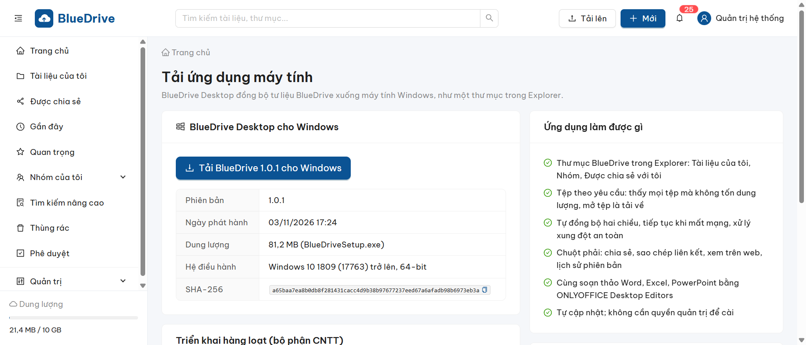
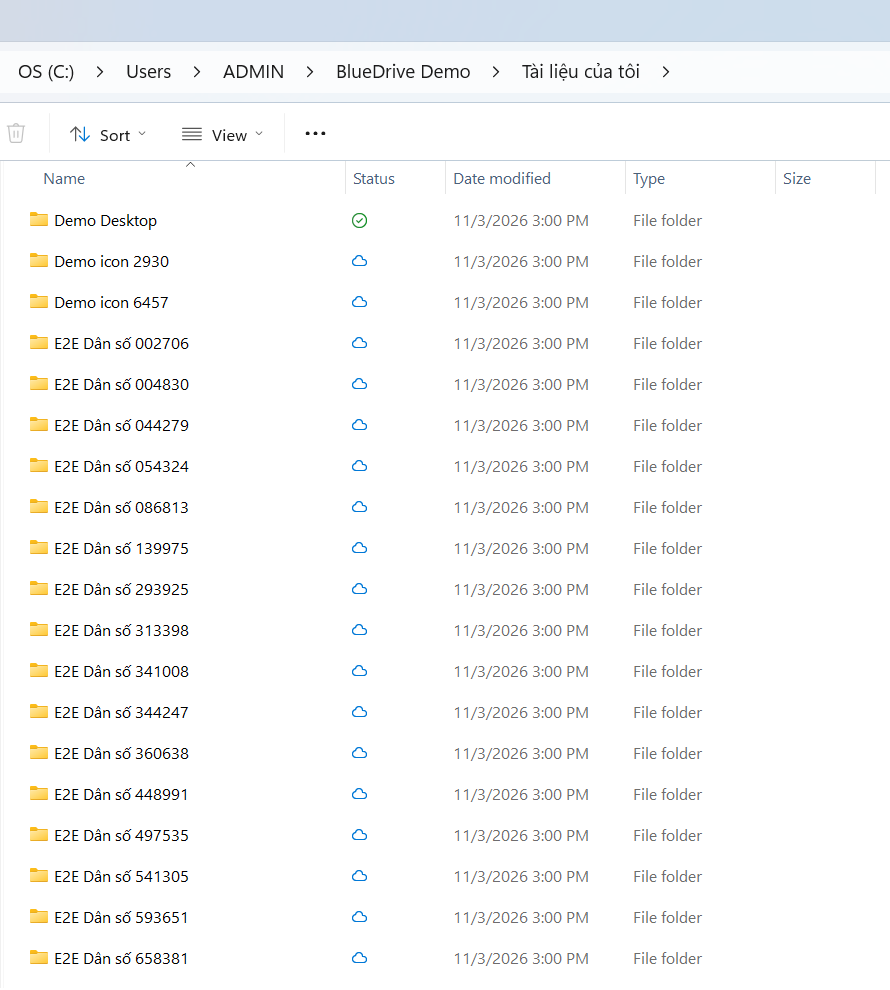
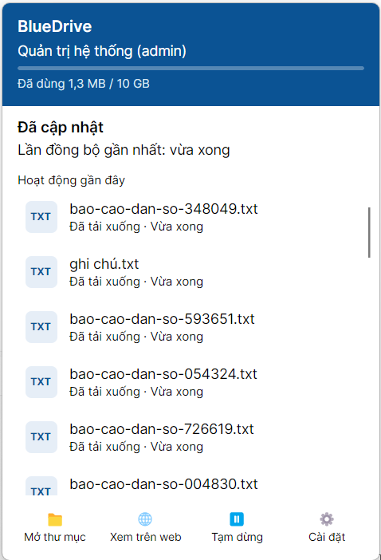
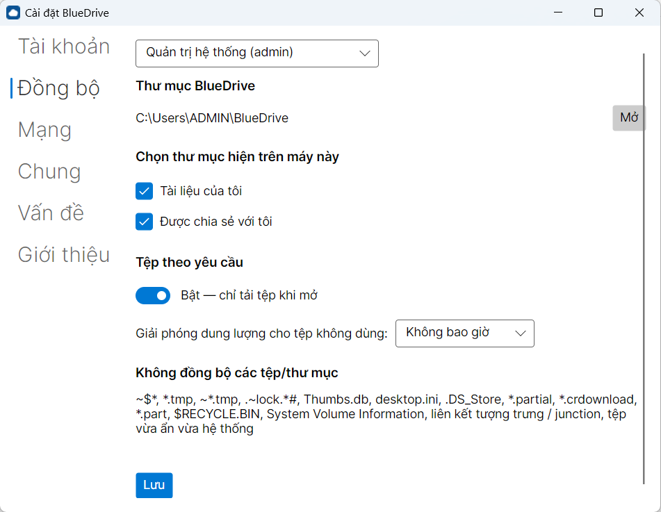

# Hướng dẫn sử dụng BlueDrive Desktop

BlueDrive Desktop đưa tư liệu trên hệ thống BlueDrive xuống một thư mục trên máy tính Windows. Bạn làm việc với tệp như bình thường
(mở bằng Word, Excel, trình xem ảnh…); mọi thay đổi tự đồng bộ hai chiều với BlueDrive.

## 1. Thiết lập lần đầu

Tải bộ cài trên web: menu tài khoản → **Tải ứng dụng máy tính** (cài đặt chi tiết, cài hàng loạt: `huong-dan-cai-dat-desktop.md`).

1. Mở **BlueDrive** (trình đơn Start). Nhập **địa chỉ máy chủ** do đơn vị cung cấp (ví dụ `https://bluedrive.bluestar.com.vn`) → **Tiếp**.
   Nếu bộ cài đã có sẵn địa chỉ, ô này bị khóa.
2. Bấm **Đăng nhập bằng trình duyệt**. Trình duyệt mở trang đăng nhập BlueDrive; đăng nhập rồi bấm **Cho phép**. Quay lại cửa sổ thiết lập:
   dòng "Đã đăng nhập: …" xuất hiện. Ứng dụng không hỏi mật khẩu; thông tin đăng nhập được mã hóa và chỉ lưu trên máy này.
3. Chọn **thư mục BlueDrive** (mặc định `C:\Users\<tên bạn>\BlueDrive`). Ứng dụng kiểm tra quyền ghi và dung lượng trống.
   **Tệp theo yêu cầu** (khuyên dùng, ổ NTFS): mọi tệp hiện đầy đủ trong Explorer nhưng chỉ tải về khi mở.
4. Chọn **nội dung đồng bộ**: Tài liệu của tôi, từng nhóm/đơn vị, Được chia sẻ với tôi.
5. Tùy chọn: khởi động cùng Windows, hiện thông báo → **Hoàn tất**.

## 2. Thư mục BlueDrive trong Explorer

- Mục **"BlueDrive - <Họ tên>"** ở khung bên trái Explorer.
- Cột **Trạng thái**:
  - ☁ đám mây: tệp chỉ có trên mạng, không chiếm dung lượng; mở là tự tải về (có tiến độ).
  - ✔ dấu tích viền xanh: đã có trên máy (sau khi mở), có thể được giải phóng khi cần.
  - ✔ dấu tích nền xanh: **luôn giữ trên thiết bị**.
  - ⟳ mũi tên: đang đồng bộ.
- Chuột phải tệp/thư mục:
  - **Luôn giữ trên thiết bị**: tải về ngay và giữ, dùng được khi không có mạng.
  - **Giải phóng dung lượng**: bỏ nội dung khỏi máy, tệp vẫn còn trên BlueDrive.
- Tệp bạn chỉ có quyền **xem**: không xóa / đổi tên được từ máy; nếu sửa, bản sửa được chuyển vào thư mục `_Không đồng bộ được`.
- Không gian **chỉ xem trực tuyến** theo chính sách của đơn vị: không giữ tệp trên máy được; nội dung tự giải phóng sau khi đóng tệp.

### Menu chuột phải "BlueDrive"

Chuột phải một tệp/thư mục trong thư mục BlueDrive → **BlueDrive** (Windows 11: **Hiện thêm tùy chọn** → BlueDrive):

- **Chia sẻ…**: mời người hoặc nhóm (Chỉ xem / Xem và tải xuống / Chỉnh sửa, kèm lời nhắn), xem ai đang được chia sẻ (kể cả kế thừa từ thư mục cha)
  và hủy chia sẻ; tab **Liên kết** tạo liên kết có thể đặt mật khẩu, ngày hết hạn, bắt buộc đăng nhập — liên kết tự được sao chép.
- **Sao chép liên kết BlueDrive**: liên kết nội bộ, người nhận cần có quyền truy cập.
- **Xem trên web**: mở mục trên trang BlueDrive.
- **Lịch sử phiên bản…**: lưu bản sao của phiên bản cũ hoặc **khôi phục** thành phiên bản hiện tại (không mất phiên bản nào).
- **Giải quyết xung đột…**: chỉ hiện với tệp "Bản xung đột".
- **Cùng soạn thảo bằng ONLYOFFICE** (tệp Word/Excel/PowerPoint/PDF/OpenDocument): mở tài liệu trong ONLYOFFICE Desktop Editors, đã đăng nhập
  sẵn, cùng chỉnh sửa trực tiếp với người khác; mỗi lần lưu là một phiên bản mới trên BlueDrive và tự đồng bộ về máy. Chưa cài ONLYOFFICE
  thì tài liệu mở trên trình duyệt. Trong ONLYOFFICE, BlueDrive cũng hiện ở **Đám mây đã kết nối** để duyệt và mở tệp.
- **Cùng soạn thảo trên trình duyệt**: mở trình soạn thảo trên trang BlueDrive.

Không thể tạo tệp/thư mục ngay ở cấp ngoài cùng của thư mục BlueDrive, ở cấp ngoài cùng "Được chia sẻ với tôi" hoặc trong thư mục chỉ xem:
những mục đó được chuyển vào `_Không đồng bộ được` và hiện trong **Cài đặt → Vấn đề**.

## 3. Biểu tượng khay hệ thống và bảng BlueDrive

Biểu tượng đám mây BlueDrive ở góc phải thanh tác vụ (bấm **^** nếu bị ẩn):

| Biểu tượng | Ý nghĩa |
|---|---|
| Dấu tích xanh | Đã cập nhật |
| Mũi tên tròn | Đang đồng bộ |
| Hai gạch đứng | Đã tạm dừng |
| Đám mây xám, dấu x | Ngoại tuyến — thay đổi sẽ được đồng bộ khi có mạng |
| Dấu chấm than đỏ | Có mục cần bạn xử lý (lỗi, xung đột, xác nhận xóa) |
| Hình người cam | Cần đăng nhập lại |

Bấm biểu tượng để mở **bảng BlueDrive**: tài khoản và dung lượng đã dùng, trạng thái, tệp đang tải lên/tải xuống, **hoạt động gần đây**
(nhấp đúp để mở tệp, chuột phải → **Mở vị trí**), và các nút **Mở thư mục**, **Xem trên web**, **Tạm dừng** (2 giờ / 8 giờ / 24 giờ / tới khi
tiếp tục, **Đồng bộ ngay**), **Cài đặt** (Cài đặt, Trợ giúp, Thoát BlueDrive).

**Xóa nhiều tệp cùng lúc**: nếu bạn xóa hơn 100 tệp (hoặc hơn 30% số tệp của một thư mục gốc), BlueDrive tạm dừng việc xóa trên máy chủ và hỏi:
**Xóa cả trên BlueDrive** hoặc **Khôi phục các tệp**.

## 4. Xung đột

Khi một tệp được sửa ở cả máy này và nơi khác (máy khác, trình duyệt) trước khi kịp đồng bộ, BlueDrive giữ **cả hai**: bản trên BlueDrive ở tên
gốc, bản của bạn thành `Tên (Bản xung đột - Họ tên - Tên máy - năm-tháng-ngày giờphút).đuôi`. Không mất nội dung nào.

Vào **Cài đặt → Vấn đề → Xử lý xung đột…** để so sánh hai bản (kích thước, thời gian, người sửa, xem trước ảnh/văn bản) và chọn:

- **Giữ cả hai** (mặc định).
- **Giữ bản trên máy**: bản của bạn thành phiên bản mới trên BlueDrive; bản kia vẫn còn trong **lịch sử phiên bản** trên web.
- **Giữ bản trên BlueDrive**: bản xung đột trên máy được chuyển vào Thùng rác.

## 5. Cài đặt

| Tab | Nội dung |
|---|---|
| Tài khoản | Các tài khoản trên máy (thư mục, chế độ, dung lượng), **Thêm tài khoản** (máy chủ khác hoặc tài khoản khác), **Hủy liên kết máy này** (ngừng đồng bộ; tệp đã tải về được giữ, tệp chỉ có trên mạng được gỡ khỏi máy và vẫn còn trên BlueDrive). |
| Đồng bộ | Mở thư mục BlueDrive; **chọn thư mục hiện trên máy này** — cả thư mục gốc lẫn thư mục con (bỏ chọn: thư mục được gỡ khỏi máy sau khi mọi thay đổi đã lên BlueDrive, vẫn còn nguyên trên BlueDrive); bật/tắt **tệp theo yêu cầu** (tắt: mọi tệp được tải về trước); **giải phóng dung lượng cho tệp không dùng** sau 1/7/14/30/60 ngày; danh sách tệp không đồng bộ (tệp tạm, tệp khóa của Office, `Thumbs.db`, `desktop.ini`, liên kết tượng trưng…). |
| Mạng | Giới hạn băng thông tải lên/tải xuống (KB/giây), proxy (theo Windows, không dùng, tự nhập), **tạm dừng khi dùng mạng tính phí** và **khi chạy pin dưới 20%** (mặc định bật). |
| Chung | Khởi động cùng Windows, thông báo, giao diện sáng/tối/theo hệ thống. |
| Vấn đề | Danh sách xung đột và mục chưa đồng bộ được, với **Xử lý xung đột…**, **Giữ cả hai**, **Thử lại**, **Mở vị trí**. |
| Giới thiệu | Phiên bản, **Xuất gói chẩn đoán…** (nhật ký + thông tin hệ thống, đã ẩn mã đăng nhập, không chứa nội dung tệp) để gửi bộ phận hỗ trợ, **Gửi yêu cầu hỗ trợ** (mở trang Hỗ trợ của BlueDrive); trạng thái ONLYOFFICE Desktop Editors, nút **Cài BlueDrive vào ONLYOFFICE** và **Cài / cập nhật ONLYOFFICE Desktop Editors** (cần quyền quản trị), thông tin giấy phép AGPL v3 của ONLYOFFICE; **Cập nhật**: tình trạng, **Kiểm tra bản cập nhật**, **Khởi động lại để cập nhật**, nhận bản thử nghiệm (beta). |

## 6. Câu hỏi thường gặp

- **Tệp đang mở trong Word có đồng bộ không?** Có — BlueDrive chờ tới khi bạn lưu và đóng tệp rồi mới tải lên (thông báo "sẽ đồng bộ khi tệp
  được đóng" trong Vấn đề trong lúc chờ).
- **Tệp rất lớn, mạng chập chờn?** BlueDrive tải tiếp từ chỗ dừng, kể cả sau khi tắt máy; nội dung được kiểm tra bằng mã băm.
- **Mất mạng thì sao?** Cứ làm việc bình thường với tệp đã có trên máy; khi có mạng, mọi thay đổi tự lên BlueDrive.
- **Lỡ xóa cả thư mục BlueDrive?** BlueDrive dừng đồng bộ và báo lỗi, **không xóa gì trên máy chủ**. Khôi phục thư mục từ Thùng rác rồi mở lại.
- **Quản trị viên thu hồi máy này?** Đồng bộ dừng, tệp trên máy được giữ; đăng nhập lại nếu được cấp lại quyền. Lệnh **xóa dữ liệu từ xa**
  (có chữ ký số) xóa thư mục BlueDrive và thông tin đăng nhập trên máy, dữ liệu trên BlueDrive không bị ảnh hưởng.
