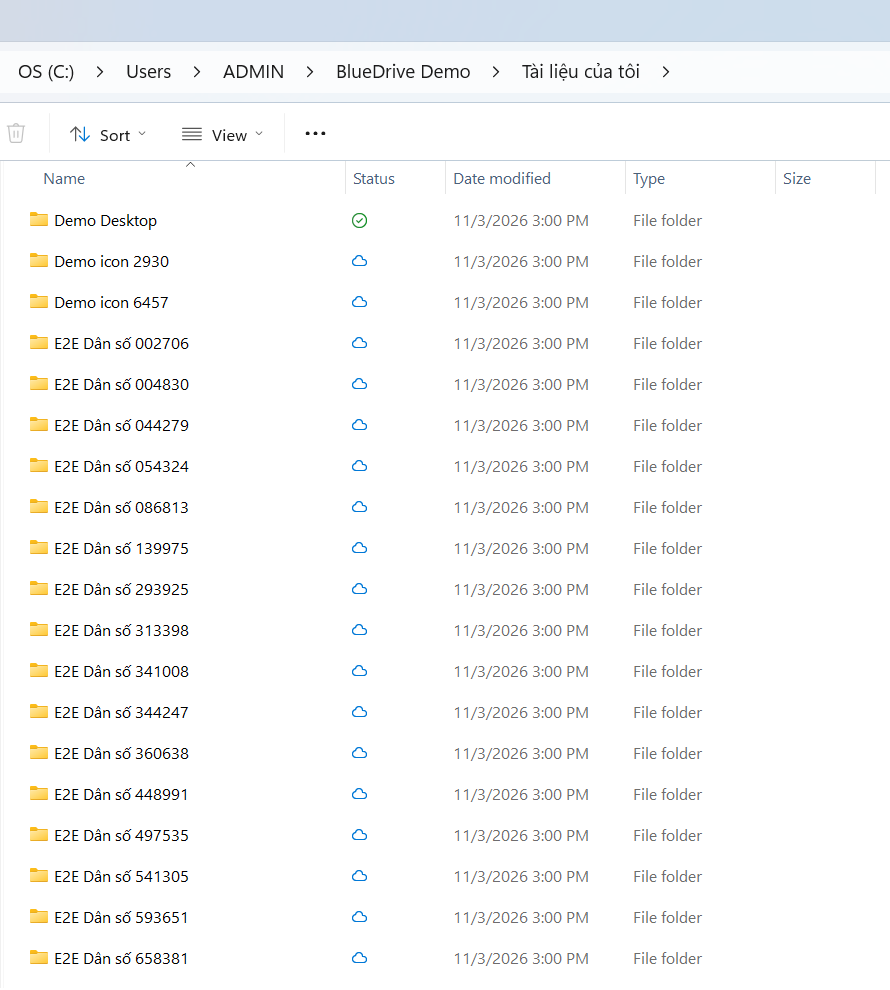

# BlueDrive Desktop — kiến trúc đồng bộ

Tài liệu này mô tả phần **máy chủ** (Sync-Phase 1) mà ứng dụng BlueDrive Desktop dựa vào. Các phần phía máy khách (engine,
Cloud Files API, giao diện) được bổ sung ở các phase sau, kèm `sync-algorithm.md` (bảng quyết định đối soát 3 chiều).

## 1. Tổng quan

```
BlueDrive Desktop ──HTTPS──► /api/v1/connect/token        (PKCE, phiên thiết bị)
       │            ──HTTPS──► /api/v1/sync/*             (roots, snapshot, changes, items, content, batch, policy)
       │            ──HTTPS──► /api/v1/files|folders|items (thao tác thường + If-Match)
       │            ──HTTPS──► /tus                        (tải lên tiếp tục được, metadata đồng bộ)
       └──WebSocket──► /hubs/sync                          (changes_available, device_status)

API ── SaveChanges ──► ChangeJournalInterceptor ──► change_journal (cùng transaction)
Worker ─ SaveChanges ─┘                                    ▲
SyncChangeBroadcaster (API, 1 giây/lần) ───────────────────┘──► SignalR nhóm "ws:{workspace}"
```

## 2. Nhật ký thay đổi (`change_journal`)

| Cột | Ý nghĩa |
|---|---|
| `seq` (identity, tăng đơn điệu) | Vị trí toàn cục; client lưu làm `cursor` |
| `workspace_id`, `item_id`, `item_type` (`file`/`folder`/`workspace`) | Mục bị thay đổi |
| `op` | `create`, `update_content`, `update_meta`, `rename`, `move`, `delete`, `restore`, `purge`, `permission_changed` |
| `parent_id`, `name`, `path`, `version_id`, `revision`, `size_bytes`, `content_hash` | Trạng thái **sau** thay đổi |
| `modified_by`, `device_id`, `modified_at`, `occurred_at` | Ai / thiết bị nào thay đổi (client bỏ qua thay đổi của chính mình để tránh vòng lặp) |

- Ghi bởi `ChangeJournalInterceptor` trong **cùng `SaveChanges`** với nghiệp vụ, nên không thể lệch. Thay đổi do Worker ghi
  (ảnh thu nhỏ, trạng thái quét mã độc) **không** được ghi và **không** tăng `revision`.
- Thay đổi quyền (`shares`, `resource_permissions`, `workspace_members`, cờ `break_inheritance`) ghi `permission_changed`.
- Thao tác hàng loạt bằng `ExecuteDelete` (xóa vĩnh viễn trong thùng rác) tự ghi dòng `purge`.
- Job `sync-journal-retention` (01:45 hằng ngày) xóa dòng cũ hơn `sync.journal_retention_days` (mặc định 90). Client có cursor
  cũ hơn mốc này nhận **410 Gone** và phải đồng bộ lại toàn bộ.

## 3. ETag và điều kiện `If-Match`

- Mỗi tệp/thư mục có cột `revision`, tăng khi có thay đổi được ghi journal. ETag = `"<revision>"`.
- Các API sẵn có `PUT /files/{id}/name`, `PUT /folders/{id}`, `POST /items/move`, `POST /items/delete` nhận header
  `If-Match` (một mục): lệch thì **412** kèm `current` (metadata hiện tại); thành công trả header `ETag` mới. Web/mobile không
  gửi header nên không bị ảnh hưởng.
- Tải lên (tus metadata hoặc form multipart): `base_etag` (412 nếu bản server đã đổi), `content_hash` (SHA-256 hex, kiểm tra
  sau khi ghép chunk → 422 nếu lệch), `conflict=fail` (409 khi trùng tên thay vì tự đổi thành `Tên (1).ext`),
  `workspace_id`/`parent_id`/`target_file_id` là bí danh của các khóa cũ.

## 4. API `/api/v1/sync`

| Endpoint | Mô tả |
|---|---|
| `POST /sync/devices` | Cập nhật đăng ký của thiết bị đang gọi (tên máy, hệ điều hành, phiên bản) |
| `GET /sync/devices/current?appVersion=` | Trạng thái thiết bị: `active` / `revoked` / `wipe_pending` / `wiped`, `updateRequired`, lệnh xóa từ xa đã ký |
| `POST /sync/devices/current/wiped` | Báo đã xóa xong dữ liệu theo lệnh |
| `GET /sync/policy` | Chính sách: bật/tắt, kích thước tối đa, đuôi tệp bị chặn, nhóm chỉ trực tuyến, phiên bản tối thiểu, xem-chỉ-đọc dạng liên kết, chu kỳ poll |
| `GET /sync/roots` | "Tài liệu của tôi" (`ws:{id}`, kind `personal`), mỗi nhóm/đơn vị (`ws:{id}`), "Được chia sẻ với tôi" (`shared`) |
| `GET /sync/snapshot?root_id=&page_token=&folder_id=` | Toàn bộ cây (1000 mục/trang, thư mục cha trước con, rồi tệp), `cursor` = vị trí journal lúc bắt đầu; `folder_id` để liệt kê lại một nhánh sau khi đổi quyền |
| `GET /sync/changes?cursor=&limit=500` | `{ changes[], nextCursor, hasMore }`; chỉ thay đổi người dùng được thấy, kèm metadata hiện tại; mất quyền → `access_revoked`; cursor quá cũ → 410 |
| `GET /sync/items/{id}` | Metadata một mục (header `ETag`) |
| `GET /sync/items/{id}/content?version=` | Chuyển hướng tới URL ký ngắn hạn, hỗ trợ **HTTP Range**; áp dụng chính sách kích thước/đuôi tệp; ghi nhật ký Tải xuống |
| `GET /sync/items/{id}/web-url` | Địa chỉ mở trên web (menu "Xem trên web") |
| `POST /sync/items/{id}/share-link` | Tạo liên kết chia sẻ (mật khẩu, hạn dùng, yêu cầu đăng nhập) — menu "Chia sẻ… / Sao chép liên kết" |
| `POST /sync/batch` | Tối đa 500 thao tác `create_folder` (`parent_ref` tham chiếu thư mục tạo trong lô), `move`, `rename`, `delete` (có `if_match`); kết quả theo từng thao tác (200/412/4xx) |

Mục đồng bộ (`SyncItemDto`): `id`, `type`, `rootId`, `workspaceId`, `parentId` (null = cấp gốc), `name`, `eTag`, `revision`,
`versionId`, `size`, `hash` (SHA-256), `modifiedAt`, `canDownload`, `canEdit`.

**Quyền**: `WorkspaceAccessMap` tính quyền hiệu lực cho toàn bộ cây trong bộ nhớ (thành viên, ACL kế thừa, chia sẻ, ngắt kế
thừa, quy trình phê duyệt) theo cùng quy tắc với `ResourceAuthorizationService`, để một cây 100.000 mục chỉ cần vài truy vấn.
Tư liệu chỉ có quyền **Xem** có `canDownload = false`: không tải nội dung xuống máy (endpoint content trả 403); client hiện
liên kết "Mở trên web" hoặc ẩn đi theo `viewOnlyAsLink`.

Gốc "Được chia sẻ với tôi" gồm các mục trong nhóm/không gian **không** thuộc thư mục gốc của người dùng nhưng được chia sẻ hoặc
phân quyền trực tiếp; mục có thư mục cha không được thấy nằm ở cấp gốc (`parentId = null`).

## 5. Thông báo đẩy `/hubs/sync`

- Kết nối (Bearer token, hoặc `?access_token=` cho WebSocket) tham gia nhóm `ws:{id}` cho mọi workspace đang đồng bộ và
  `device:{id}`. Gọi `Resubscribe()` sau khi nhận `permission_changed`.
- `changes_available { workspaceId, latestSeq }`: do `SyncChangeBroadcaster` đọc journal mỗi giây (gom cả thay đổi do Worker
  ghi), tức gộp/debounce 1 giây; client gọi `/sync/changes`. Không có kết nối thì poll theo `pollSeconds` (mặc định 30).
- `device_status { deviceId, status }` khi thiết bị bị thu hồi hoặc có lệnh xóa từ xa.

## 6. Thiết bị, đăng nhập, chính sách

- **Đăng nhập (OAuth 2.0 Authorization Code + PKCE, RFC 7636/8252)**: ứng dụng mở trình duyệt hệ thống tới
  `/connect/authorize?client_id=bluedrive-desktop&redirect_uri=http://127.0.0.1:{port}/callback&code_challenge=…&code_challenge_method=S256&state=…&device_name=…`.
  Người dùng đăng nhập web BlueDrive và bấm **Cho phép**; trình duyệt quay về địa chỉ loopback với `code` (một lần, 2 phút).
  Ứng dụng gọi `POST /api/v1/connect/token` (`grant_type=authorization_code`, `code_verifier`, `device_name`, `device_os`,
  `app_version`, `machine_id`) và nhận `access_token`, `refresh_token` (mặc định 90 ngày, `sync.device_refresh_days`),
  `device_id`, `device_secret` (chỉ trả một lần, lưu DPAPI). Làm mới: `grant_type=refresh_token`.
  *Giả định*: tự cài đặt luồng PKCE trên hệ JWT/phiên sẵn có thay vì OpenIddict, để giữ nguyên thu hồi phiên, audit và chuỗi
  băm nhật ký; endpoint tương đương `/connect/authorize` và `/connect/token` của spec.
- **Phiên thiết bị** (`user_sessions.device_id`): token có claim `did`, **không** bị đăng xuất khi không hoạt động (timeout rảnh
  của web), bị thu hồi cùng thiết bị. Mọi thao tác ghi nhật ký kèm `deviceId` và `source = desktop_sync`.
- **Bảng `devices`**: tên máy, hệ điều hành, phiên bản ứng dụng, băm machine id, lần thấy cuối, IP cuối, trạng thái
  `active` / `revoked` / `wipe_pending` / `wiped`. Đăng nhập lại trên cùng máy dùng lại bản ghi.
- **Thu hồi** (trang "Thiết bị đã kết nối" của người dùng hoặc quản trị `device.admin`): thu hồi mọi phiên của thiết bị.
- **Xóa dữ liệu từ xa**: trạng thái `wipe_pending`; ứng dụng nhận lệnh qua `/sync/devices/current` hoặc `device_status`, kiểm tra
  chữ ký `HMAC-SHA256(device_secret, "wipe:{deviceId}:{requestedAt:O}")` (chống lệnh giả), xóa thư mục đồng bộ, bộ nhớ đệm, token,
  rồi gọi `…/wiped` → `wiped` và thu hồi phiên.
- **Chính sách** (`/admin/settings`, nhóm "Đồng bộ máy tính"): `sync.enabled`, `sync.allowed_roles`, `sync.allowed_organizations`
  (gồm đơn vị con), `sync.max_file_size_mb`, `sync.blocked_extensions`, `sync.online_only_workspaces`, `sync.min_client_version`,
  `sync.view_only_as_link`, `sync.device_refresh_days`, `sync.journal_retention_days`, `sync.poll_seconds`.

## 7. Thư viện máy khách `BlueDrive.Sync.Client`

| Thành phần | Việc làm |
|---|---|
| `DesktopAuthenticator` | Đăng nhập OAuth 2.0 + PKCE (S256): mở trình duyệt tới `/connect/authorize`, nhận mã qua socket loopback `127.0.0.1:<cổng ngẫu nhiên>/callback` (kiểm tra `state`), đổi mã tại `/api/v1/connect/token`. |
| `DeviceAuthHandler` | Gắn access token; hết hạn hoặc gặp 401 → làm mới một lần (token xoay vòng). Làm mới thất bại (thiết bị bị thu hồi/xóa từ xa) → xóa token, báo `SignInRequiredException`. |
| `HttpRemoteStore` | Cài đặt `IRemoteStore`: snapshot/changes, tải xuống qua URL ký có **Range** (mất kết nối → tải tiếp từ byte đã nhận), tải lên ≤ 4 MB bằng multipart, lớn hơn bằng **tus** (khối 8 MB, `HEAD` lấy offset để tải tiếp), tạo thư mục / đổi tên / di chuyển / xóa qua `/sync/batch` với `if_match`. |
| Ánh xạ lỗi | 409 → trùng tên, 412 → bản máy chủ đã đổi (kèm mục hiện tại), 404 → đúng mục bị thiếu (mục hay thư mục đích), 410 → đồng bộ lại toàn bộ, 401 → đăng nhập lại, 408/429/5xx/mạng → tạm thời, còn lại (403, 413, 415, chặn loại tệp…) → vĩnh viễn. |
| Thử lại | Polly: chỉ các yêu cầu **lũy đẳng** (liệt kê, tải xuống, khối tus) được thử lại với backoff lũy thừa + jitter, ngắt mạch khi máy chủ lỗi liên tục. Thao tác thay đổi dữ liệu không gửi lại mù quáng; engine lập lại kế hoạch ở vòng sau (mất phản hồi → hai bên cùng hash → liên kết, không tạo bản trùng). |
| `BandwidthLimiter`, `ThrottledStream` | Giới hạn băng thông tải lên/tải xuống (byte/giây, đổi được khi đang chạy, 0 = không giới hạn). |
| `SyncNotifications` | SignalR `/hubs/sync` (`changes_available`, `device_status`, tự kết nối lại + `Resubscribe`) và hỏi định kỳ dự phòng (5 phút; 30 giây khi mất kết nối hub). |

Kiểm thử: `tests/BlueDrive.IntegrationTests/DesktopClientTests.cs` chạy engine thật trên API thật (Testcontainers): 2 máy tạo/sửa/đổi tên/xung đột/xóa, tải tiếp bằng Range, ánh xạ lỗi, làm mới token, đẩy SignalR; `desktop/tests/BlueDrive.Sync.Tests/ClientTests.cs`: PKCE loopback, chặn `state` giả, giới hạn băng thông.

## 8. Tiến trình nền `BlueDrive.Sync.Agent` (chế độ đồng bộ đầy đủ)

Mỗi tài khoản có một `SyncAgent` chạy `SyncEngine` trên thư mục thật (`PhysicalFileSystem`, `IPlaceholderProvider` = không dùng placeholder).

| Thành phần | Việc làm |
|---|---|
| `PhysicalFileSystem` | Đường dẫn tương đối, phân cách `/`. Windows: **NTFS File ID** (`GetFileInformationByHandleEx`) nhận diện tệp qua đổi tên/di chuyển. Ghi qua tệp tạm `.…bluedrive-tmp` rồi thay thế một bước, giữ mtime của máy chủ. Xóa vào **Thùng rác** (không hộp thoại). Không đi theo liên kết tượng trưng/junction, bỏ qua tệp vừa ẩn vừa hệ thống. Đọc để tải lên với `FileShare.Read`: tệp đang được trình soạn thảo ghi sẽ chờ. |
| `LocalChangeWatcher` | `FileSystemWatcher` (bộ đệm 64 KB) chỉ báo "có thay đổi"; engine luôn quét lại nên mất sự kiện không gây sai. Tràn bộ đệm → đồng bộ ngay. |
| `SyncAgent` | Chạy một lượt khi: máy chủ đẩy `changes_available`, thư mục yên 3 giây sau thay đổi (tối đa 30 giây), định kỳ 15 phút, "Đồng bộ ngay". Mất mạng → thử lại 1 giây → 30 phút có jitter. Đầu mỗi lượt kiểm tra thiết bị: bị thu hồi → dừng, giữ tệp; **xóa từ xa** chỉ thực hiện khi chữ ký HMAC (bí mật thiết bị) hợp lệ; phiên bản cũ hơn mức tối thiểu → dừng, yêu cầu cập nhật. |
| An toàn dữ liệu | Thư mục đồng bộ hoặc thư mục của một gốc **biến mất** (xóa nhầm, ổ rút ra) → không chạy lượt nào, báo lỗi; không bao giờ coi đó là xóa hàng loạt trên máy chủ. Tệp đang mở/bị khóa → bỏ qua mục đó trong lượt (báo "sẽ đồng bộ khi tệp được đóng"), các mục khác vẫn chạy. |
| `AccountStore` | `%LOCALAPPDATA%\BlueDrive\accounts.json` (không chứa bí mật) + mỗi tài khoản một thư mục: `state.db`, `tokens.dat` mã hóa **DPAPI** (người dùng hiện tại). Thư mục gốc: "Tài liệu của tôi", mỗi nhóm/đơn vị một thư mục, "Được chia sẻ với tôi"; không gian "chỉ trực tuyến" theo chính sách không được tải xuống ở chế độ này. |

Dòng lệnh (trước khi có ứng dụng khay ở Sync-Phase 6):

```powershell
bluedrive-sync login https://bluedrive.bluestar.com.vn [--folder D:\BlueDrive]   # đăng nhập bằng trình duyệt
bluedrive-sync run       # đồng bộ mọi tài khoản, Ctrl+C để dừng
bluedrive-sync status    # tài khoản, số mục, xung đột, hoạt động gần nhất
bluedrive-sync logout https://bluedrive.bluestar.com.vn                           # gỡ tài khoản, giữ tệp
```

## 9. Tệp theo yêu cầu trên Windows (`BlueDrive.Sync.Windows`, Cloud Files API)



| Thành phần | Việc làm |
|---|---|
| `SyncRootRegistrar` | Đăng ký thư mục BlueDrive của tài khoản bằng `StorageProviderSyncRootManager` (id `BlueDrive!<SID>!<tài khoản>`): Explorer hiện mục "BlueDrive - <Họ tên>" ở khung điều hướng, cột Trạng thái, lệnh "Luôn giữ trên thiết bị / Giải phóng dung lượng". Windows âm thầm bỏ qua thư mục trong `%TEMP%`/AppData nên sau khi đăng ký luôn kiểm tra lại; không được thì dùng `CfRegisterSyncRoot` (vẫn có tệp theo yêu cầu, không có khung điều hướng). Chính sách: hydrate toàn bộ (cho phép tự giải phóng), tạo sẵn toàn bộ cây (`ALWAYS_FULL`), theo dõi thay đổi để bỏ dấu "đã đồng bộ". |
| `CloudPlaceholders` | Engine tạo **tệp giữ chỗ** (đúng kích thước, ngày sửa, `FileIdentity` = mã mục BlueDrive) thay vì tải nội dung; bản mới trên máy chủ → cập nhật giữ chỗ và bỏ nội dung cũ (tệp đang "luôn giữ" thì tải lại ngay); sau mỗi lượt các mục vừa đồng bộ được đánh dấu "đã đồng bộ" (tệp/thư mục tạo trên máy được chuyển thành giữ chỗ để sau này giải phóng được). |
| `CloudProvider` | Callback của bộ lọc: `FETCH_DATA` tải đúng đoạn được yêu cầu bằng HTTP Range (`HttpRemoteStore.ReadRangeAsync`, tự tải tiếp khi rớt mạng), chuyển theo khối 4 MB, báo tiến độ cho Explorer; hủy khi ứng dụng thôi đọc; lỗi → ứng dụng nhận lỗi ngay. `NOTIFY_DELETE/RENAME`: chương trình khác xóa/đổi tên mục **chỉ xem** bị từ chối; thao tác của chính BlueDrive luôn được phép. Đóng tệp sau khi ghi → đồng bộ sớm. |
| `CloudFilesPlatform` | Ghép các phần trên cho `SyncAgent`. Theo dõi thuộc tính ghim: "Luôn giữ trên thiết bị" → tải về; "Giải phóng dung lượng" → bỏ nội dung. Không gian **chỉ trực tuyến** theo chính sách: không cho ghim, tự giải phóng sau khi đóng tệp. Tệp chưa từng tải bị xóa thì xóa hẳn (không qua Thùng rác). |

Tệp theo yêu cầu dùng cho ổ NTFS trên Windows 10 1809 trở lên; ổ FAT32/exFAT/ổ mạng dùng chế độ đồng bộ đầy đủ (mục 8). `bluedrive-sync login … --full` để chọn đồng bộ đầy đủ.

Kiểm thử (`desktop/tests/BlueDrive.Sync.Windows.Tests`, chỉ chạy trên Windows, tự đăng ký rồi gỡ sync root tạm): tệp xuất hiện dạng giữ chỗ và chỉ tải khi mở; giải phóng / luôn giữ (cả bằng `attrib +P/+U` như Explorer); sửa trên máy lên máy chủ, bản mới từ web thay giữ chỗ; chương trình khác không xóa được tệp chỉ xem.

## 10. Ứng dụng `BlueDrive.Desktop` (Avalonia 11)

- `Program`: một phiên bản duy nhất (mutex dùng chung với `bluedrive-sync`; lần mở thứ hai gửi tín hiệu qua named pipe để phiên đang chạy hiện bảng),
  nhật ký Serilog `%LOCALAPPDATA%\BlueDrive\logs` (xoay vòng theo ngày, giữ 14 ngày). `--background` khi khởi động cùng Windows.
- `AppHost`: các tài khoản (`AccountSession` = `SyncAgent` + kết nối SQLite chỉ đọc riêng cho giao diện), cài đặt `settings.json`
  (không chứa bí mật), giới hạn băng thông dùng chung, proxy, khởi động cùng Windows (`HKCU\…\Run`, chỉ ghi sau khi người dùng xác nhận),
  công việc "giải phóng dung lượng tệp lâu không dùng", hủy liên kết (gỡ tệp giữ chỗ chưa tải + gỡ sync root), đổi chế độ tệp theo yêu cầu.
- `SyncAgent` bổ sung cho giao diện: tạm dừng có thời hạn, chọn thư mục gốc đồng bộ (lưu `excluded_roots`), giải quyết xung đột, tiến độ
  truyền tải, khóa lượt (thao tác từ giao diện không chạy đè engine), gói chẩn đoán (`Diagnostics`, che token/mật khẩu).
- Cửa sổ: `WizardWindow`, `FlyoutWindow` (góc phải trên thanh tác vụ, tự ẩn khi mất focus), `SettingsWindow`, `ConflictWindow`; thông báo Windows
  qua `Microsoft.Toolkit.Uwp.Notifications`. Hướng dẫn người dùng: `huong-dan-su-dung-desktop.md`.

## 11. Tích hợp Explorer (Sync-Phase 7)

| Thành phần | Việc làm |
|---|---|
| Menu chuột phải `ExplorerMenu` | Menu con "BlueDrive" cho tệp/thư mục **trong thư mục BlueDrive** (điều kiện `AppliesTo` theo đường dẫn), đăng ký theo người dùng (`HKCU\Software\Classes`), không cần quyền quản trị: **Chia sẻ…**, **Sao chép liên kết BlueDrive**, **Xem trên web**, **Lịch sử phiên bản…** (tệp), **Giải quyết xung đột…** (chỉ hiện với bản xung đột). Lệnh gửi `--share/--link/--web/--versions/--resolve "<đường dẫn>"` tới phiên BlueDrive đang chạy (named pipe, JSON). Trên Windows 11 menu nằm trong "Hiện thêm tùy chọn"; menu hiện đại `IExplorerCommand` cần định danh gói MSIX (Sync-Phase 9); Status UI của Explorer xem dòng "7.2 Status UI". |
| `LocalIndex` | Đường dẫn trên máy → mục BlueDrive (theo bản ghi base). |
| `BlueDriveApi` | Liên kết web (`/sync/items/{id}/web-url`), chia sẻ người/nhóm (`/shares`, `/users/lookup`, `/user-groups`), liên kết có mật khẩu/hạn dùng (`/sync/items/{id}/share-link`), phiên bản (`/files/{id}/versions`, khôi phục, tải bản cũ). |
| Cửa sổ | `ShareWindow` (Mời người: tìm người/nhóm, quyền Chỉ xem / Xem và tải xuống / Chỉnh sửa, danh sách đang chia sẻ kể cả kế thừa; Liên kết), `VersionsWindow` (lưu bản sao, khôi phục thành phiên bản hiện tại), `ConflictWindow`. |
| Chỉ đọc | Tệp chỉ có quyền xem có thuộc tính **ReadOnly** (cả tệp giữ chỗ); được cấp quyền sửa thì bỏ thuộc tính. Engine chỉ đổi những tệp có thay đổi quyền (lưu danh sách đã đánh dấu). |
| Cấp không được ghi | Tệp/thư mục tạo trong thư mục chỉ xem hoặc ở cấp ngoài cùng "Được chia sẻ với tôi" (máy chủ trả 403) được chuyển vào `_Không đồng bộ được` (xung đột loại `not_allowed`) thay vì báo lỗi mãi; mục đặt trực tiếp ở cấp ngoài cùng của thư mục BlueDrive (chỉ chứa các thư mục gốc) cũng vậy. |
| Đổi quyền một tệp | Chia sẻ một **tệp** sinh `permission_changed` cho tệp đó: client lấy lại chính mục đó thay vì liệt kê "thư mục" (trước đây trả 404 làm hỏng lượt đồng bộ). |

## 12. Độ tin cậy (Sync-Phase 8)

| Vấn đề | Cách xử lý |
|---|---|
| Tệp rất lớn (5 GB) | Tải lên: tệp > 32 MB được **chụp nội dung ra tệp tạm trên đĩa** (`…\<tài khoản>\snapshots`, tự xóa khi đóng; dọn khi khởi động) và tính SHA-256 trong lúc chép, không nạp vào RAM. Tải xuống: ghi thẳng vào tệp tạm của bước ghi nguyên tử qua `HashingStream`, sai mã băm thì bỏ tệp tạm, tệp cũ giữ nguyên. |
| Mất mạng / tắt máy giữa lúc tải lên | Địa chỉ phiên tus được nhớ trong `state.db` theo (đích, tên, mã băm, kích thước): lần sau (kể cả sau khi khởi động lại) `HEAD` lấy vị trí rồi gửi tiếp phần còn thiếu; phiên đã hết hạn trên máy chủ thì tạo phiên mới. Tải xuống tiếp bằng HTTP Range. |
| Tắt đột ngột giữa lượt (kill) | Mỗi bước an toàn khi dừng bất kỳ lúc nào (base ghi ngay sau bước); kiểm thử dừng agent ngẫu nhiên 4 lần giữa chừng: đủ tệp, không trùng, không bản xung đột thừa. Mô phỏng FsCheck có crash ngẫu nhiên: 10.000 chuỗi đạt. |
| Mạng tính phí / pin yếu | `ConditionsMonitor` (Windows): tạm dừng khi mạng có chi phí (gói dữ liệu, chuyển vùng, vượt hạn mức) hoặc chạy pin dưới 20%; tắt được trong Cài đặt → Mạng. Tạm dừng tự động tách biệt với tạm dừng của người dùng; mở tệp theo yêu cầu vẫn tải được. |
| Hết dung lượng (413) | Tệp đó báo trong Vấn đề, thông báo "Hết dung lượng BlueDrive" một lần; thay đổi giữ trên máy và tự tải lên khi có chỗ. |
| Đường dẫn > 260 ký tự | .NET tự dùng `\?\`; các lời gọi Win32 trực tiếp (File ID, mở tệp giữ chỗ) thêm tiền tố; ứng dụng khai báo `longPathAware`. |
| Chọn thư mục đồng bộ (cả thư mục con) | Danh sách thư mục loại trừ theo từng gốc (`excluded_folders:<gốc>`); engine bỏ cả cây con khỏi 3 cây khi lập kế hoạch (không tải về, không coi là bị xóa). Bỏ chọn: đồng bộ trước, gỡ thư mục khỏi máy (Thùng rác), quên bản ghi; chọn lại: tải về. |
| Cursor quá cũ (410), xóa hàng loạt, tên tệp / hoa-thường / NFC, `access_revoked` | Đã có từ Sync-Phase 2 (xem `sync-algorithm.md`). |

USN Journal (tùy chọn trong đặc tả) chưa dùng: FileSystemWatcher + quét định kỳ đã bắt đủ thay đổi, và engine luôn quét lại trước khi lập kế hoạch.

## 13. Cùng soạn thảo bằng ONLYOFFICE Desktop Editors (Sync-Phase 8b)

Chi tiết nghiên cứu và giới hạn: `docs/onlyoffice-desktop-integration.md`.

| Thành phần | Việc làm |
|---|---|
| Provider `bluedrive` | `desktop/onlyoffice-provider/bluedrive/` (config + biểu tượng), sinh theo máy chủ; `OnlyOfficeService` tìm `DesktopEditors.exe` (App Paths / Program Files), báo trạng thái Chưa cài / Thiếu provider / Provider cũ / Sẵn sàng, cài provider (cần quyền quản trị thì xin nâng quyền). |
| Menu chuột phải | "Cùng soạn thảo bằng ONLYOFFICE" (`--coedit`): xin vé dùng một lần (`POST /onlyoffice-desktop/tickets`) rồi mở `DesktopEditors.exe "<liên kết vé>"`; chưa cài ONLYOFFICE thì mở trình duyệt. "Cùng soạn thảo trên trình duyệt" (`--coedit-web`). Chỉ hiện với tệp Office. |
| Web | `/oo-desktop` (`portal:login`), `/oo-desktop/open?ticket=` (đổi vé → phiên web → trang soạn thảo), `/oo-desktop/logout` (`portal:logout`); trong Desktop Editors ẩn thanh đầu trang và mở tệp Office bằng `open:document`. |
| Đồng bộ | Mỗi lần lưu từ ONLYOFFICE là một phiên bản mới trên máy chủ; agent nhận thay đổi và tải tệp mới xuống như mọi thay đổi khác. |

## 14. Đóng gói, cài đặt, cập nhật (Sync-Phase 9)

Chi tiết cài đặt: `huong-dan-cai-dat-desktop.md`; hiệu năng: `bao-cao-hieu-nang.md`.

| Thành phần | Việc làm |
|---|---|
| Bộ cài EXE (Velopack 1.2.161) | `desktop/packaging/build.ps1`: publish self-contained win-x64, ký số (`sign.ps1`, chứng thư từ biến môi trường, không có thì tự ký), `vpk pack` (id `BlueDrive.Desktop`, cài theo người dùng vào `%LOCALAPPDATA%\BlueDrive.Desktop`, lối tắt Desktop + Start), `BlueDriveSetup.exe`, gói cập nhật `releases.<kênh>.json`, `releases.json` (phiên bản, dung lượng, SHA-256). |
| MSIX | `desktop/packaging/msix/` (manifest + `build-msix.ps1`): cùng tệp, `windows.startupTask`, `unvirtualizedResources` (dữ liệu và registry như bản EXE). Gói khai báo thêm menu Explorer hiện đại (`IExplorerCommand`) và Status UI (`cloudFiles2:StorageProviderStatusUISourceFactory` + `com:ExeServer`). |
| Hook Velopack (`Program.Main`) | Cài: đăng ký "Khởi động cùng Windows" (bản im lặng không tự mở ứng dụng). Gỡ: `Uninstaller` (dừng phiên đang chạy qua `--quit`, gỡ sync root, menu, khóa Run, provider ONLYOFFICE, mã đăng nhập; hỏi giữ tệp / gỡ ONLYOFFICE, tự chọn mặc định sau 12 giây). Không tự áp dụng bản cập nhật khi khởi động (không dừng cứng phiên đang đồng bộ). |
| Cấu hình triển khai (`Deployment`) | Chính sách `HKLM\|HKCU\SOFTWARE\Policies\BlueDrive` (`Server`, `InstallOnlyOffice`, `UpdateChannel`, `DisableUpdates`) > tham số `--server=` / `--with-onlyoffice=` > `deploy.json` cạnh `BlueDrive.exe`; lưu vào `settings.json`. Script `install-bluedrive.ps1` cho GPO/Intune. |
| Tự cập nhật (`Updater`) | Nguồn `<máy chủ>/downloads/desktop/` (Velopack `SimpleWebSource`, kênh stable/beta), kiểm tra lúc khởi động + mỗi 6 giờ, tải nền; cài khi thoát hoặc "Khởi động lại để cập nhật" (khay, Cài đặt → Giới thiệu). Bản MSIX / bản phát triển không tự cập nhật. |
| ONLYOFFICE (`OnlyOfficeSetup`) | Tải bộ cài chính thức theo kiến trúc, `WinVerifyTrust` + chủ thể "Ascensio System SIA", một lần nâng quyền cài im lặng + chép provider; phiên bản tối thiểu 8.0. Tùy chọn ở trình hướng dẫn (mặc định bật) hoặc chính sách. |
| Phát hành | `.github/workflows/desktop-release.yml` (tag `desktop-v*`, máy Windows) → GitHub Release; VM: `scripts/sync-desktop-downloads.sh` (gọi trong `deploy-vm.sh`) chép bản ổn định/beta mới nhất vào `deploy/downloads/desktop/`, nginx phục vụ `/downloads/desktop/` (tệp JSON không cache). |
| Web | `/desktop-app` "Tải ứng dụng máy tính" (menu tài khoản, trang Thiết bị đã kết nối): tải EXE/MSIX, SHA-256, ghi chú phát hành, kênh beta, lệnh triển khai hàng loạt. |
| Hiệu năng | Quét thư mục bằng `FileIdExtdDirectoryInfo` (một lời gọi mỗi thư mục, không mở handle từng tệp), `Stat` một handle, trả bộ nhớ GC sau lượt lớn. Công cụ đo: `desktop/tools/BlueDrive.Sync.Perf`. |

## 15. macOS (Sync-Phase 10)

Chế độ đồng bộ đầy đủ với cùng engine .NET (Tệp theo yêu cầu kiểu File Provider chưa làm — mục tùy chọn của đặc tả).

| Thành phần | Việc làm |
|---|---|
| Ứng dụng | `BlueDrive.Desktop` build hai đích: `net10.0-windows10.0.22621.0` (Cloud Files, Explorer, toast) và `net10.0` (macOS/Linux). Mã chỉ dành cho Windows nằm sau `#if WINDOWS` (`CloudFiles`, `Notifier`, WinRT trong `ConditionsMonitor` / `PackageInfo`). Biểu tượng ở thanh menu, không hiện trên Dock (`MacOSPlatformOptions.ShowInDock = false`); bảng BlueDrive mở ở góc trên bên phải. |
| Theo dõi thay đổi | `FileSystemWatcher` (FSEvents trên macOS) + quét định kỳ như Windows. |
| Mã tệp | inode (`lstat`: `u:<thiết bị>:<inode>`) — đổi tên/di chuyển vẫn là cùng tệp (đặc tả 6.1). |
| Tên tệp | macOS trả tên dạng NFD: `PhysicalFileSystem` chuẩn hóa NFC khi quét; APFS không phân biệt dạng chuẩn hóa nên mở bằng tên NFC vẫn đúng tệp. |
| Mã đăng nhập | Keychain đăng nhập của người dùng (`KeychainTokenStore`, dịch vụ "BlueDrive", mỗi tài khoản một mục). |
| Xóa | Vào Thùng rác (`~/.Trash`); Linux: thùng rác freedesktop (`~/.local/share/Trash` + `.trashinfo`). |
| Khởi động cùng máy | LaunchAgent `~/Library/LaunchAgents/vn.bluestar.bluedrive.plist` (`--background`). |
| Thông báo | Notification Center (`osascript display notification`). |
| Tạm dừng khi pin yếu | `pmset -g batt` (mạng tính phí: chưa đo được trên macOS). |
| Triển khai hàng loạt | `/Library/Application Support/BlueDrive/deploy.json` (`server`, `withOnlyOffice`, `channel`, `disableUpdates`). |
| Đóng gói, cập nhật | `desktop/packaging/macos/build-macos.sh` (trên máy Mac): publish `osx-arm64`, biểu tượng `.icns`, Velopack `.app` + `BlueDrive.pkg`, kênh cập nhật `osx-stable` / `osx-beta` cùng thư mục `/downloads/desktop/`. Ký Developer ID + notarize khi có chứng thư (biến `BLUEDRIVE_MAC_*`). |
| Kiểm thử | Job CI `Desktop (macOS)` (máy macOS của GitHub): `Sync.Tests` gồm `UnixDiskTests` (inode qua đổi tên, NFD→NFC, Thùng rác, Keychain, đồng bộ hai chiều trên đĩa thật) + build ứng dụng `osx-arm64`; các test Unix cũng chạy trên Linux trong job backend. |

## 16. Linux (Sync-Phase 11)

Cùng đích `net10.0` với macOS, chế độ đồng bộ đầy đủ.

| Thành phần | Việc làm |
|---|---|
| Khay hệ thống | `TrayIcon` của Avalonia qua DBus StatusNotifierItem (AppIndicator: GNOME cần tiện ích AppIndicator, KDE/XFCE có sẵn). |
| Mã tệp, xóa | inode (`lstat`, glibc < 2.33: `__lxstat64`); thùng rác freedesktop (`~/.local/share/Trash/files` + `info/*.trashinfo`). |
| Mã đăng nhập | `~/.local/share/BlueDrive/<tài khoản>/tokens.json`, quyền 0600 (không phụ thuộc Secret Service). |
| Khởi động cùng máy, thông báo, pin | `~/.config/autostart/bluedrive.desktop`; `notify-send`; `/sys/class/power_supply/BAT*`. |
| Triển khai hàng loạt | `/etc/bluedrive/deploy.json`. |
| Đóng gói | `desktop/packaging/linux/build-linux.sh` (trên Linux): AppImage (Velopack, tự cập nhật kênh `linux-stable` / `linux-beta`) và `.deb` (`/opt/bluedrive`, lệnh `bluedrive`, mục ứng dụng; cập nhật qua apt/CNTT). Đã chạy thử trong container Ubuntu (dotnet/sdk:10.0): đóng gói xong, ứng dụng khởi động dưới Xvfb. |

## 17. Tải lên theo khối thay đổi (Sync-Phase 12, nâng cao)

| Thành phần | Việc làm |
|---|---|
| Chia khối | FastCDC (chuẩn hóa mức 2; khối 32 KB – 128 KB trung bình – 512 KB; bảng gear cố định) — một tệp mã nguồn dùng chung `src/BlueDrive.Application/Features/Sync/FastCdc.cs` (BlueDrive.Sync.Core liên kết tới), nên máy và máy chủ cắt cùng ranh giới. Chèn/xóa vài byte chỉ đổi các khối lân cận. |
| Máy chủ | `GET /api/v1/sync/items/{id}/chunks` (quyền tải xuống): danh sách khối của phiên bản hiện tại. `POST /api/v1/sync/items/{id}/delta` (quyền sửa): `manifest` (mọi khối của bản mới) + `chunks` (chỉ khối máy chủ chưa có); máy chủ ghép từ phiên bản hiện tại + khối mới (kiểm SHA-256 từng khối), rồi lưu như tải lên thường: `base_etag` (412), `content_hash`, hạn mức, quét virus, phiên bản mới, nhật ký có `deviceId`. |
| Máy | Phiên bản mới của tệp ≥ 8 MB: lấy danh sách khối (cùng revision với base), chia khối bản trên máy, nếu phần thay đổi ≤ 70 % thì gửi delta (đọc thẳng từ ảnh chụp nội dung, không nạp RAM); ngược lại, máy chủ cũ, hay base đã đổi → tải lên toàn bộ như trước (tus, tiếp tục được). |
| Kết quả | Sửa 1 MB giữa tệp 20 MB: gửi ~2 MB thay vì 20 MB (IT `DesktopClientTests.Editing_part_of_a_large_file_sends_only_the_changed_chunks`). |
| Chưa làm (tùy chọn trong đặc tả) | **Máy chủ lưu khối dùng chung (dedup)**: máy chủ vẫn lưu mỗi phiên bản thành một blob mã hóa riêng (AES-256-GCM theo blob; sao lưu/khôi phục, thùng rác, hạn mức, quét mã độc, xem trước, ONLYOFFICE đều đọc blob này) — đổi sang kho khối dùng chung là thay đổi kiến trúc lưu trữ của toàn hệ thống, chưa làm; tải lên theo khối đã bỏ phần lớn băng thông khi sửa tệp lớn. |

### Đồng bộ trong mạng LAN (Sync-Phase 12)

| Thành phần | Việc làm |
|---|---|
| Bật | Cài đặt → Mạng → "Đồng bộ trong mạng LAN" (mặc định tắt; áp dụng ở lần khởi động sau) hoặc chính sách `LanSync` (DWORD 0/1, khóa ô chọn); `install-bluedrive.ps1 -LanSync 1` ghi chính sách và, khi chạy quyền quản trị, tạo quy tắc tường lửa cho `BlueDrive.exe` (mạng miền/riêng). |
| Tìm máy | `LanPeers` (`desktop/src/BlueDrive.Sync.Client/LanPeers.cs`): mỗi tài khoản phát thông báo UDP broadcast cổng 47391 mỗi 30 giây (`net` = băm địa chỉ máy chủ, mã phiên, cổng TCP); máy khác máy chủ bị bỏ qua; máy không thấy lại sau 2 phút bị quên. |
| Máy chủ | `POST /api/v1/sync/lan/tickets` (`CreateLanTicketCommand`): chỉ thiết bị Desktop; chạy đúng kiểm tra + nhật ký tải xuống (`GetSyncContentUrlQuery`), trả vé ngẫu nhiên, khóa AES-256, SHA-256 và kích thước; vé lưu băm trong bộ nhớ 2 phút. `POST /api/v1/sync/lan/confirm` (`ConfirmLanTicketCommand`): máy cho tải (thiết bị khác thiết bị xin vé, có quyền xem tệp) nhận lại tệp nào, mã băm và khóa; tối đa 3 lần xác nhận. |
| Truyền | TCP: máy nhận gửi vé; máy cho tải hỏi máy chủ, tìm bản trên máy đúng phiên bản và chưa đổi (mã băm, kích thước, thời gian, mã tệp như lúc đồng bộ; tệp giữ chỗ chưa tải về không gửi), gửi từng khung 1 MiB mã hóa AES-GCM (nonce ngẫu nhiên, AAD = số khung, khung rỗng kết thúc). Tối đa 4 lượt gửi cùng lúc. |
| Nhận | `HttpRemoteStore.DownloadAsync`: tệp ≥ 1 MB và có máy cùng mạng → xin vé, thử tối đa 3 máy (kết nối 2 giây), nhận vào tệp tạm, kiểm tra SHA-256 + kích thước rồi mới ghi vào đích (engine vẫn kiểm tra mã băm như mọi lần tải); lỗi → tải từ máy chủ như cũ. |
| Kiểm thử | IT `LanSyncTests` (hai máy thật trên API thật: máy B nhận tệp 3 MB từ máy A; vé theo quyền của cả hai máy, phiên web không xin được vé); `LanPeersTests` (mã hóa + kiểm tra, vé giả, sai khóa, sai phiên bản, bản trên máy đã đổi, máy chết, tìm nhau bằng UDP và bỏ qua máy khác máy chủ). |

## 18. Bổ sung theo đặc tả (sau Sync-Phase 12)

| Mục đặc tả | Thực hiện |
|---|---|
| 8.3 Số luồng song song | Cài đặt → Mạng → "Số luồng tải song song" (1–8, mặc định 4): ở chế độ đồng bộ đầy đủ, mỗi vòng tải trước song song nội dung các tệp cần tải về (≤ 64 MB/tệp, ≤ 1 GB/vòng) vào tệp tạm đã kiểm mã băm; các bước vẫn chạy lần lượt (trạng thái SQLite, thứ tự cha–con không đổi). Tải lên vẫn từng tệp (tus tiếp tục được, tải lên theo khối). |
| 13A Ai đang chỉnh sửa | Máy chủ ghi nhận người đang soạn từ callback Document Server (trạng thái 1: danh sách người; 2/3/4: đóng) — `OfficeEditingTracker`; `GET /api/v1/sync/editing` trả tài liệu người dùng xem được. Ứng dụng hỏi mỗi 30 giây / sau mỗi lượt: bảng BlueDrive hiện "Đang cùng soạn trực tuyến: …"; Explorer hiện trạng thái "Đang được … chỉnh sửa trực tuyến" bên cạnh biểu tượng đồng bộ (`StorageProviderItemProperties`, chế độ tệp theo yêu cầu). |
| 13A Khóa mềm | Khi Word/Excel/PowerPoint mở bản trên máy (tệp chủ sở hữu `~$…` xuất hiện) của tài liệu đang có phiên cùng soạn: thông báo "Tài liệu đang được cùng soạn trực tuyến… Mở chế độ cùng soạn?" với nút mở ONLYOFFICE (Windows). |
| 7.2 Menu chuột phải Windows 11 | `desktop/src/BlueDrive.Shell` — COM server `IExplorerCommand` biên dịch NativeAOT (DLL native, không cần .NET trong `dllhost`), khai báo trong gói MSIX (`desktop4:FileExplorerContextMenus` + `com:SurrogateServer`): mục "BlueDrive" ngay trong menu mới (không cần "Hiện thêm tùy chọn") với các lệnh như menu cổ điển, chỉ hiện cho mục trong thư mục BlueDrive (đọc `accounts.json`), lệnh gọi `BlueDrive.exe --share/--link/…`. Bản cài EXE (Velopack, không có định danh gói) giữ menu cổ điển; bản MSIX tắt menu cổ điển. Đã chạy thử trên Windows 11 (ảnh `images/menu-windows11.png`). |
| 7.2 Status UI (`IStorageProviderStatusUISource`) | Windows 11 22H2+: nút trạng thái ở đầu thanh địa chỉ của thư mục BlueDrive (như OneDrive) mở bảng có trạng thái đồng bộ ("Đã cập nhật", "Đang đồng bộ…", "Có xung đột", "Cần xác nhận xóa"…), dung lượng đã dùng / hạn mức, "Mở BlueDrive" và "Xem trên web"; tự cập nhật khi trạng thái đổi (`StatusUIChanged`). `StatusUiServer`: lớp COM `IStorageProviderStatusUISourceFactory` do chính BlueDrive.exe phục vụ ngoài tiến trình (`CoRegisterClassObject`, luồng MTA; COM khởi động BlueDrive bằng `-Embedding` nếu chưa chạy). Gói MSIX khai báo trong manifest (`desktop3:CloudFiles` buộc kèm các handler khác — dùng CLSID giữ chỗ như mẫu CloudMirror của Microsoft); bản EXE (Velopack) đăng ký lớp trong `HKCU\Software\Classes\CLSID` và ghi giá trị `StorageProviderStatusUISourceFactory` vào khóa sync root (cách OneDrive làm). Nội dung tính ở `StatusUiModel` (kiểm thử `DesktopTests.Explorer_status_ui_shows_the_state_and_the_storage_used`); đã chạy thử với cả bản MSIX và bản EXE trên Windows 11 (ảnh `images/explorer-status-ui.png`). |
| 7.2 Trạng thái tùy chỉnh trong Explorer | Thuộc tính "Trạng thái BlueDrive" khai báo khi đăng ký sync root: "Đang được … chỉnh sửa trực tuyến", "Có xung đột — mở BlueDrive để chọn bản giữ lại". |
| 13A Nhấp đúp luôn mở chế độ cùng soạn | Cài đặt → Đồng bộ → "Khi nhấp đúp tệp Office trong BlueDrive: Mở bằng ứng dụng mặc định / Luôn mở chế độ cùng soạn (khi có mạng)" (`OfficeDoubleClick`, theo người dùng, không cần quyền quản trị). Windows không có liên kết tệp theo thư mục: verb "Mở bằng BlueDrive" có `AppliesTo` theo thư mục BlueDrive được thêm vào ProgID của từng loại tệp Office (lựa chọn của người dùng + mặc định) và đặt đầu thứ tự verb, nên chỉ trong thư mục BlueDrive nhấp đúp mới chạy `BlueDrive.exe --open`; có mạng → phiên cùng soạn (ONLYOFFICE Desktop Editors / trình duyệt), mất mạng hoặc máy chủ lỗi → bản trên máy bằng ứng dụng mặc định (verb "open"). Đăng ký lại khi đổi thư mục / khởi động (theo kịp khi người dùng đổi ứng dụng mặc định); tắt hoặc gỡ cài đặt trả lại thứ tự verb cũ. Bản MSIX chạy qua app execution alias `BlueDrive.exe`. Kèm cảnh báo khóa mềm khi mở bản trên máy trong lúc có phiên cùng soạn. |
