# Hướng dẫn sử dụng BlueDrive

BlueDrive là hệ thống lưu trữ, tìm kiếm, khai thác và chia sẻ sản phẩm truyền thông dân số (hình ảnh, video, âm thanh, tài liệu, infographic, ấn phẩm điện tử). Hệ thống dùng được trên máy tính, máy tính bảng, điện thoại (trình duyệt) và ứng dụng di động BlueDrive (Android/iOS).

Ảnh minh họa trong tài liệu được chụp tự động từ hệ thống (`web/e2e/pages.spec.ts`), thư mục `docs/images/`. Hướng dẫn cho quản trị viên: `docs/huong-dan-quan-tri.md`.

## 1. Đăng nhập, mật khẩu, phiên đăng nhập (HSMT #16–17)

- Truy cập địa chỉ hệ thống do đơn vị cung cấp, nhập **Tên đăng nhập** và **Mật khẩu**.
- **Lần đầu đăng nhập** (hoặc khi mật khẩu hết hạn), hệ thống yêu cầu **đổi mật khẩu**. Mật khẩu mới phải đủ độ dài và có chữ hoa, chữ thường, số, ký tự đặc biệt; danh sách điều kiện hiển thị và đánh dấu khi bạn gõ.
- **Quên mật khẩu**: bấm *Quên mật khẩu?*, nhập tên đăng nhập hoặc email → mở email, bấm liên kết (dùng một lần, hiệu lực 30 phút) để đặt mật khẩu mới.
- Nhập sai mật khẩu 5 lần liên tiếp, tài khoản bị **tạm khóa 15 phút**.
- Hệ thống tự đăng xuất khi không thao tác trong 30 phút (quản trị có thể thay đổi).
- Menu tài khoản (góc phải) > **Phiên đăng nhập**: xem các thiết bị đang đăng nhập (thiết bị, IP, thời gian), đăng xuất từng thiết bị hoặc *Đăng xuất khỏi tất cả thiết bị khác*.

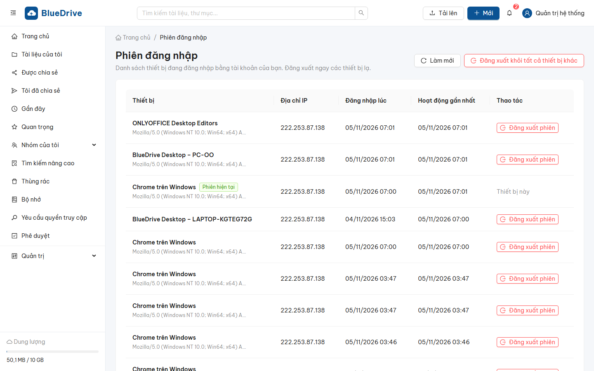

## 2. Trang chủ — Dashboard (#63–70)

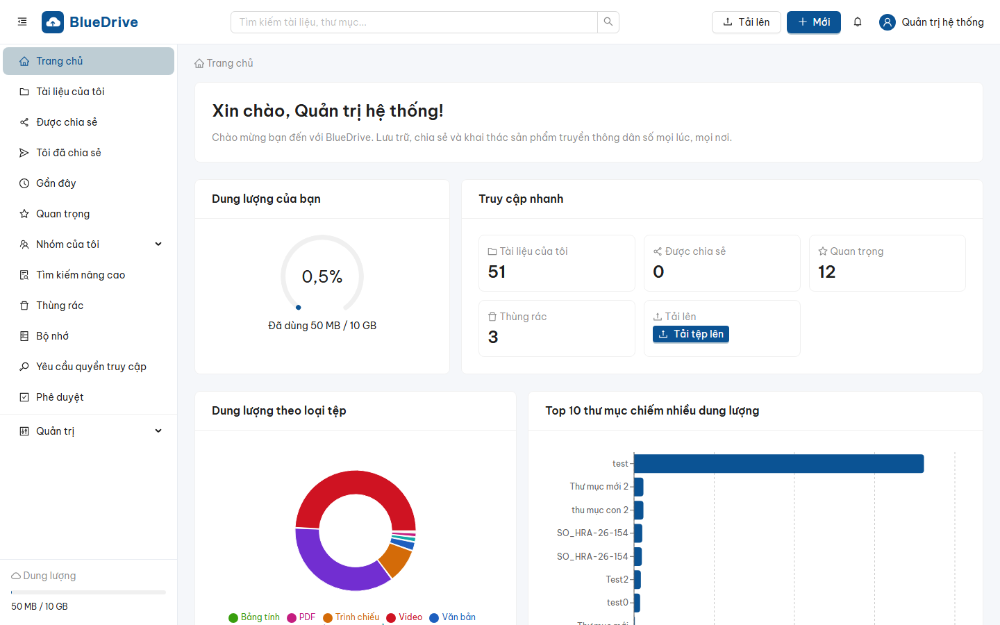

- **Dung lượng của bạn**: đã dùng / tổng dung lượng được cấp.
- **Truy cập nhanh**: Tài liệu của tôi, Được chia sẻ, Quan trọng, Thùng rác, Tải lên.
- **Dung lượng theo loại tệp** (ảnh, video, âm thanh, tài liệu, bảng tính, trình chiếu, PDF, khác).
- **Top 10 thư mục chiếm nhiều dung lượng** — bấm một cột để mở thư mục.
- **Tài liệu gần đây**: tên, người sở hữu, dung lượng, thời gian sửa.
- **Nhóm**: số nhóm bạn tham gia, số nhóm bạn làm trưởng nhóm, dung lượng từng nhóm so với hạn mức, tỷ lệ loại tệp trong nhóm, tài liệu nhóm gần đây.

## 3. Tài liệu của tôi (#18, #20–24, #44–48)

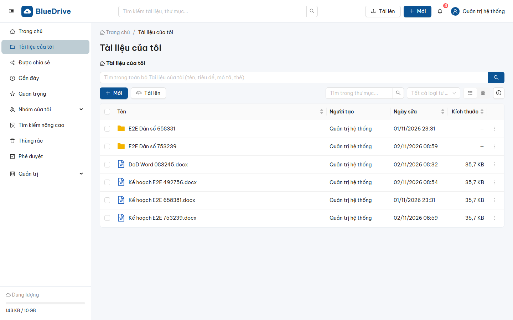

- Chuyển chế độ xem **danh sách / lưới (ảnh thu nhỏ)**, sắp xếp theo tên, kích thước, ngày sửa; lọc theo loại tư liệu; tìm trong thư mục hoặc trong toàn bộ Tài liệu của tôi (gõ có dấu hoặc không dấu).
- **Mới**: Thư mục, Tài liệu Word, Bảng tính Excel, Trình chiếu PowerPoint, Văn bản (.txt). Tài liệu mới mở ngay trong trình soạn thảo trực tuyến.
- **Tải lên**: tệp hoặc cả thư mục (giữ nguyên cây thư mục), hoặc **kéo thả** từ máy tính vào cửa sổ. Chọn tệp xong là tải lên ngay; tiêu đề, mô tả, thẻ, danh mục nhập sau trong **Thông tin** của tệp (chuột phải → Thông tin), hoặc chọn nhiều tệp → **Cập nhật thông tin hàng loạt**. Hàng đợi tải lên ở góc phải dưới: xem tiến độ, **tạm dừng / tiếp tục**, hủy, thử lại. Tệp lớn (vài GB) tiếp tục được từ chỗ dừng khi mạng gián đoạn.
- **Nhấp** vào thư mục/tệp để mở. Rê chuột vào một dòng để hiện nút nhanh cạnh tên: **⋯** (menu), **Chia sẻ**, **Sao chép liên kết** (liên kết nội bộ, người nhận đăng nhập và có quyền mới mở được), **Tải xuống**. Chọn mục bằng **ô chọn** đầu dòng (hoặc Ctrl/Shift + nhấp để chọn nhiều), **chuột phải** để mở menu: Mở, Tải xuống, Chia sẻ, Đổi tên, Sao chép tới..., Di chuyển tới..., Đánh dấu quan trọng, Thông tin, Phiên bản, Thảo luận, Quản lý quyền truy cập, Xóa. **Thông tin / Phiên bản / Thảo luận** mở ngăn bên phải đè lên danh sách (đóng bằng Esc hoặc nút ×); nút ⓘ trên thanh công cụ bật bảng thông tin cố định, khi đó danh sách cuộn ngang để xem đủ các cột.
- **Phím tắt**: `Del` xóa, `F2` đổi tên, `Ctrl+C` / `Ctrl+X` rồi `Ctrl+V` để sao chép/di chuyển vào thư mục đang mở, `Enter` mở. **Kéo thả** tệp vào một thư mục để di chuyển.
- Tải nhiều tệp/thư mục cùng lúc: hệ thống nén thành một tệp ZIP.
- **Panel thông tin** (nút ⓘ): kích thước, loại, người tạo, ngày tạo/sửa, vị trí, danh mục, mô tả, thẻ, phiên bản, **ai có quyền truy cập**. Có thể sửa tiêu đề, mô tả, thẻ, danh mục.
- Định dạng hỗ trợ: ảnh (jpg, png, gif, webp, svg, bmp, tiff, heic), video (mp4, mov, avi, mkv, webm), âm thanh (mp3, wav, aac, m4a, ogg, flac), tài liệu (doc/x, xls/x, ppt/x, pdf, txt, odt, ods, odp, rtf), ấn phẩm (pdf, epub), thiết kế (psd, ai, indd — chỉ lưu và tải), nén (zip, rar, 7z). Tệp chương trình (.exe, .bat, .ps1...) và tệp giả mạo đuôi bị chặn.

## 4. Xem và soạn thảo tài liệu (#21, #26–27, #41–43)

- Mở tệp: ảnh (phóng to, xoay), video/âm thanh (tua tự do), PDF, văn bản. Tài liệu Office: bấm **Mở bằng trình soạn thảo** để sửa trực tuyến; **nhiều người có thể cùng soạn thảo** một tài liệu, thấy thay đổi của nhau theo thời gian thực. Mỗi lần lưu tạo một phiên bản mới.
- Tab **Phiên bản**: số phiên bản, người sửa, thời gian, dung lượng, ghi chú; xem/tải phiên bản cũ; **Khôi phục** một phiên bản cũ (tạo phiên bản mới); **Tải lên phiên bản mới**.
- Tab **Thảo luận**: bình luận, trả lời, **@nhắc tên** đồng nghiệp (người được nhắc nhận thông báo), đính kèm tệp, sửa/xóa bình luận của mình. Chỉ người có quyền xem tài liệu mới thấy thảo luận.

## 5. Chia sẻ (#19, #23, #49, #53)

- Chuột phải > **Chia sẻ**:
  - **Chia sẻ nội bộ**: chọn người dùng, nhóm người dùng hoặc đơn vị; quyền *Xem*, *Xem + Tải xuống* hoặc *Chỉnh sửa*; kèm lời nhắn. Người nhận được thông báo.
  - **Chia sẻ qua liên kết**: mở tab là có ngay liên kết của tài liệu (mặc định *yêu cầu đăng nhập*, chỉ người có tài khoản mở được) — bấm **Sao chép** hoặc **mã QR**. Đổi cài đặt của chính liên kết đó (cho phép tải xuống, mật khẩu, ngày hết hạn, số lượt truy cập tối đa, tắt *yêu cầu đăng nhập* để công khai) rồi bấm **Lưu cài đặt**; **thu hồi** khi không cần nữa. Người nhận mở liên kết để xem ảnh, video, PDF, tài liệu Office (chỉ xem). Bật **Cho phép chỉnh sửa (không cần đăng nhập)** để ai có liên kết cũng sửa được tài liệu Word, Excel, PowerPoint ngay trên trình duyệt, giống Google Drive: người mở nhập tên (hiện cho người khác thấy, kèm chữ "khách") rồi cùng soạn trực tiếp với mọi người đang mở tài liệu. Mỗi lần lưu tạo phiên bản mới mang tên người tạo liên kết, nhật ký ghi rõ liên kết và tên khách. Chỉ người có quyền sửa tài liệu mới bật được; nếu người đó mất quyền sửa thì liên kết tự về chỉ xem. Nên đặt mật khẩu hoặc ngày hết hạn. Quản trị hệ thống tắt được tính năng này ở **Quản trị → Cài đặt hệ thống → Chia sẻ**.
- Mục **Được chia sẻ**: tư liệu người khác chia sẻ với bạn, lọc theo người chia sẻ, thời gian; tab *Tệp đính kèm* liệt kê tệp đính kèm trong các thảo luận.

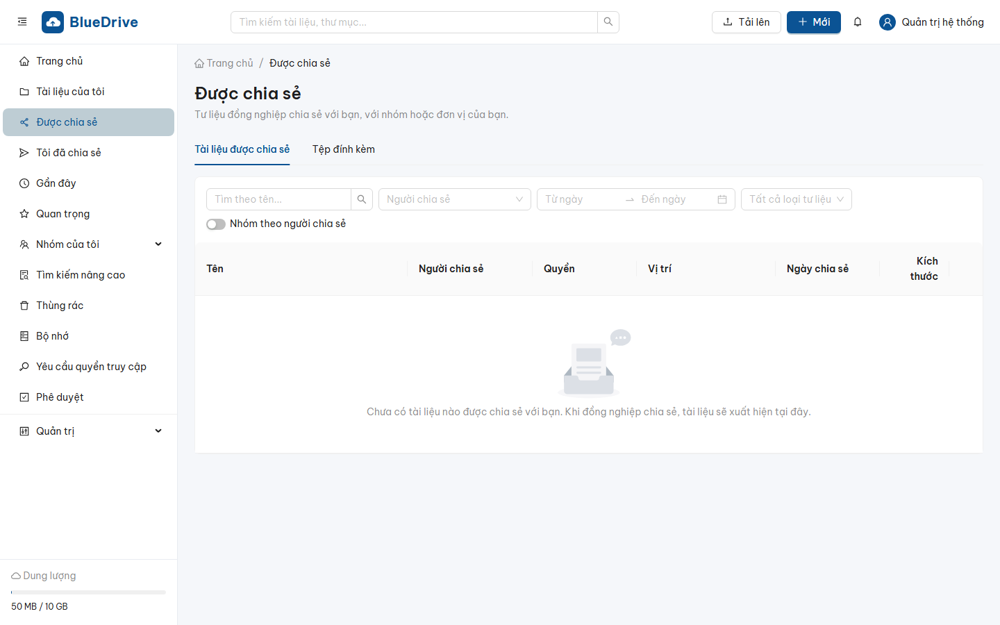

## 6. Gần đây, Quan trọng, Thùng rác (#18, #23, #61–62)

- **Gần đây**: tài liệu bạn vừa mở, sửa, tải lên.
- **Quan trọng**: tài liệu/thư mục đã đánh dấu sao.
- **Thùng rác**: chọn không gian (cá nhân hoặc nhóm), xem người xóa, thời điểm, vị trí gốc, ngày tự xóa. **Khôi phục** về vị trí cũ (nếu thư mục cũ không còn, khôi phục về thư mục gốc), **Xóa vĩnh viễn**, **Dọn sạch thùng rác**. Dung lượng chỉ được trả lại khi xóa vĩnh viễn; tệp tự xóa vĩnh viễn sau 30 ngày.

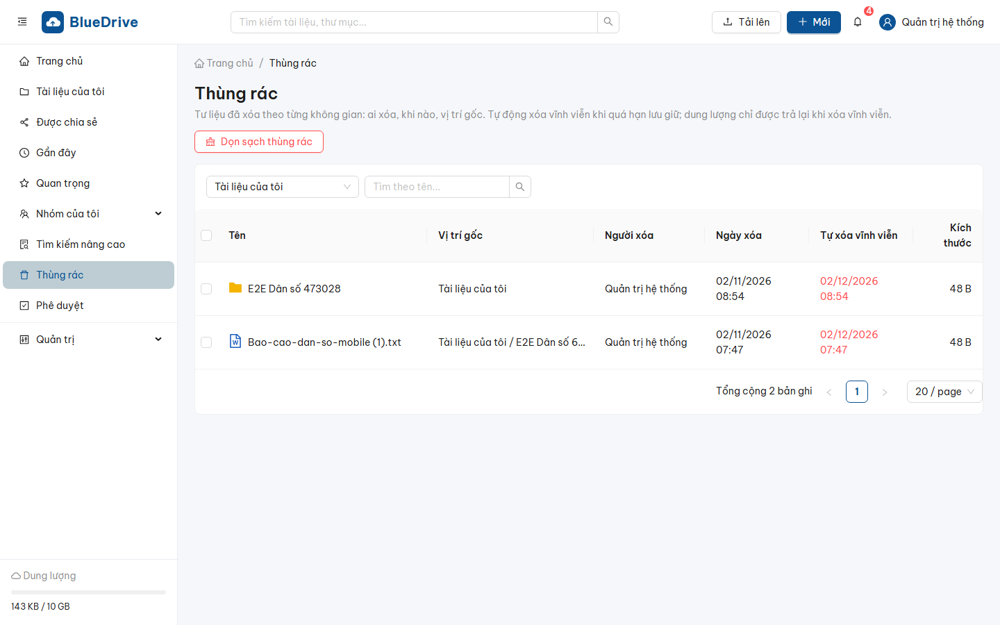

## 7. Nhóm của tôi — tư liệu dùng chung (#28–38, #57–58)

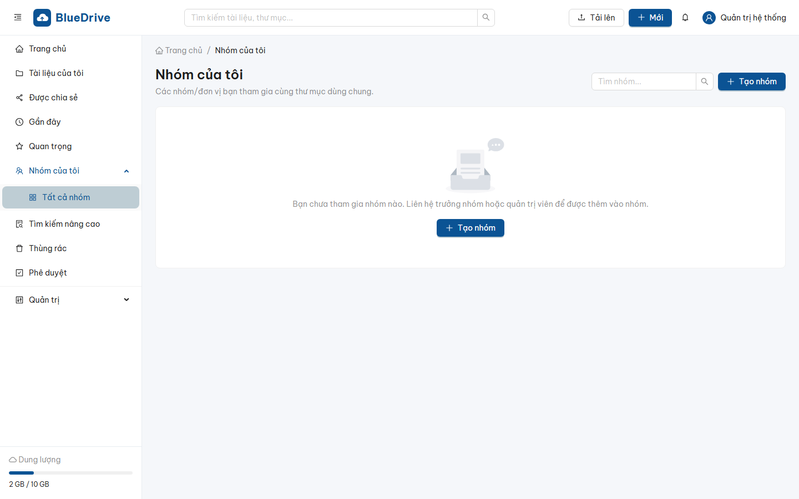

- Tạo nhóm tài nguyên của nhóm/đơn vị, mời thành viên với vai trò: *Trưởng nhóm, Quản lý, Biên tập, Tải lên, Phê duyệt, Chỉ xem*. Trưởng nhóm/quản lý có thể **khóa nhóm** (chỉ xem, không ghi).
- Trong nhóm có đầy đủ thao tác như Tài liệu của tôi (tạo mới, tải lên, tìm kiếm, chia sẻ, phiên bản, thảo luận).
- Tab **Tổng hợp tư liệu**: số lượng, dung lượng tư liệu theo từng thành viên; lọc tư liệu theo thành viên.
- Tab **Lịch sử chỉnh sửa**: dòng thời gian thao tác của các thành viên.
- **Quản lý quyền truy cập** (chuột phải thư mục/tệp): cấp quyền cho người, nhóm, đơn vị; quyền (và chia sẻ) của thư mục được kế thừa xuống mọi thư mục con và tệp bên trong, có thể **ngắt kế thừa** tại một thư mục con. Bật **Cần phê duyệt khi tải lên** cho thư mục: tư liệu tải lên chờ người có vai trò Phê duyệt duyệt trước khi hiển thị cho người chỉ xem.

## 8. Phê duyệt (#43, #54)
Người có vai trò **Phê duyệt** vào mục *Phê duyệt*: xem trước tư liệu chờ duyệt, **Duyệt** hoặc **Từ chối** (nhập lý do). Người tải lên nhận thông báo kết quả.

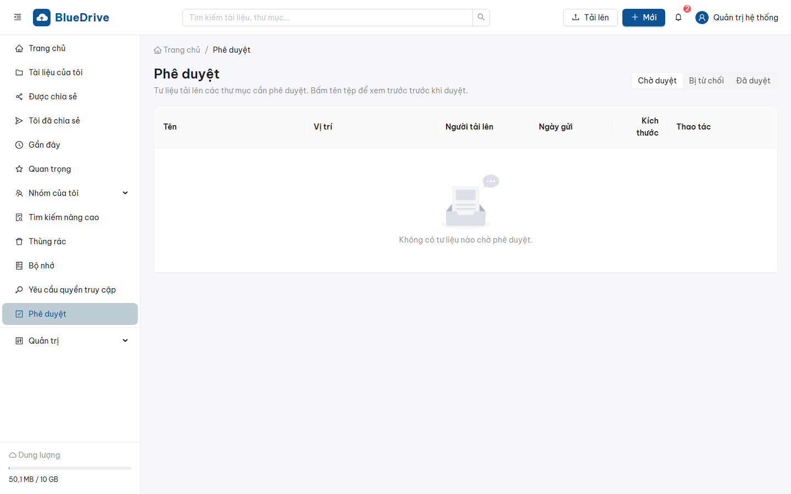

## 9. Tìm kiếm nâng cao (#20, #32, #50–51)

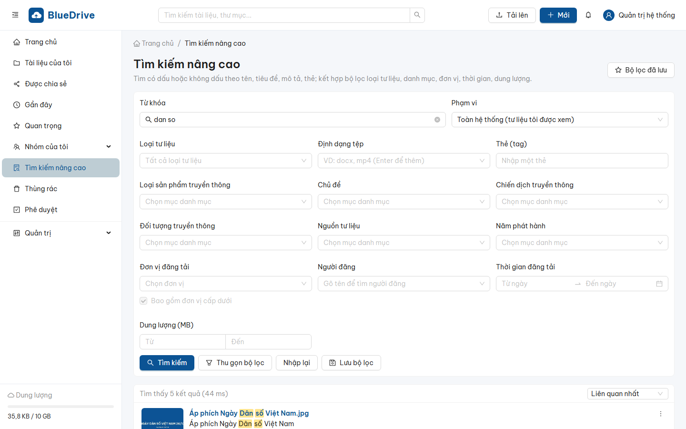

- Ô tìm kiếm trên đầu trang hoặc mục **Tìm kiếm nâng cao**. Gõ **có dấu hoặc không dấu** ("dan so" tìm được "Dân số"); tìm theo tên, tiêu đề, mô tả, thẻ.
- Bộ lọc: loại tư liệu, định dạng, danh mục (loại sản phẩm, chủ đề, chiến dịch, đối tượng...), **đơn vị đăng tải** (gồm đơn vị con), người đăng, khoảng thời gian, dung lượng, thẻ, phạm vi (toàn hệ thống hoặc một nhóm).
- Kết quả tô sáng từ khóa, hiển thị vị trí và đơn vị đăng tải; chỉ gồm tư liệu bạn có quyền xem. **Lưu bộ lọc** để dùng lại.

## 10. Hỗ trợ (#7 — mục 5.1 chất lượng dịch vụ)
Menu tài khoản > **Hỗ trợ**: gửi yêu cầu hỗ trợ/sự cố (mức độ *Khẩn cấp* hoặc *Không khẩn cấp*, mô tả, ảnh chụp màn hình), theo dõi trạng thái và kết quả xử lý. Thời hạn xử lý: khẩn cấp 4 giờ, không khẩn cấp 24 giờ.

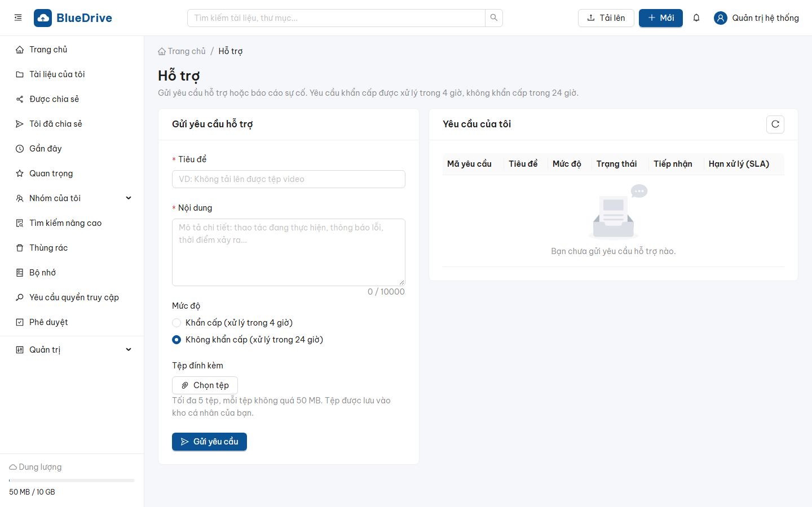

## 11. Báo cáo của tôi
Các báo cáo xuất Excel/PDF có khối lượng lớn được xử lý nền; khi xong bạn nhận thông báo, tải tệp tại *Báo cáo của tôi*.

## 12. Sử dụng trên điện thoại (#52–53, #71–84)

- **Trình duyệt điện thoại**: giao diện tự co giãn; menu trái mở bằng nút ☰.

  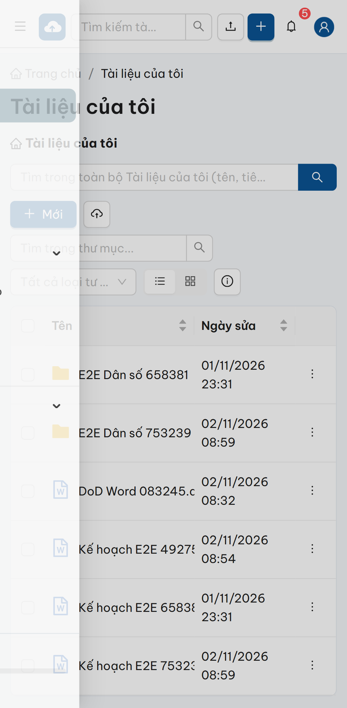

- **Ứng dụng BlueDrive** (Android/iOS): nhập địa chỉ máy chủ và đăng nhập (có thể bật mở khóa bằng vân tay/khuôn mặt). Các mục: Trang chủ, Tài liệu của tôi, Được chia sẻ, Gần đây, Nhóm, Tìm kiếm. Với mỗi tệp: mở (ảnh, video, âm thanh, PDF, Office), đổi tên, đánh dấu quan trọng, sao chép/di chuyển (chọn thư mục đích trên cây thư mục), xóa, chia sẻ liên kết, xem chi tiết, **tải xuống** về máy (ảnh/video lưu vào Thư viện). Tải ảnh/video lên từ thư viện hoặc máy ảnh. Hướng dẫn cài đặt ứng dụng: `mobile/README.md`.

  | Trang chủ | Tìm kiếm không dấu | Xem PDF/Office | Chia sẻ liên kết |
  |---|---|---|---|
  | 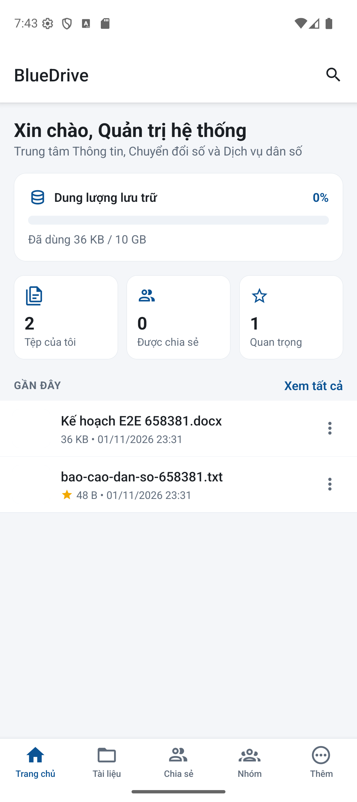 | 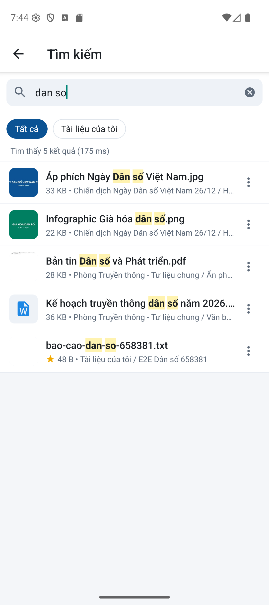 | 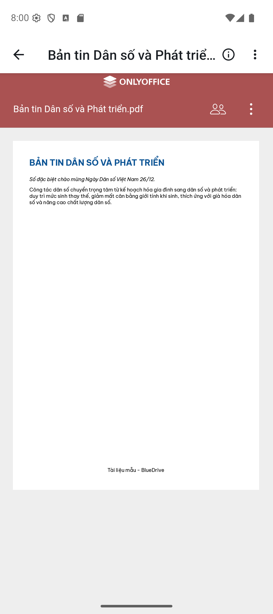 | 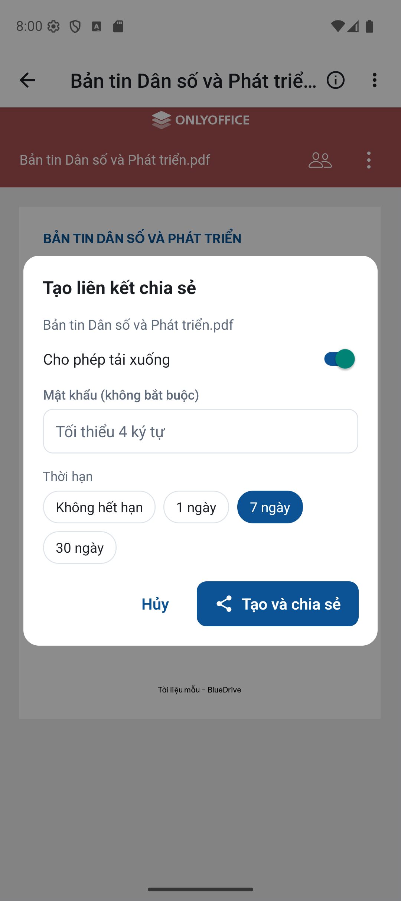 |
  | **Nhóm và đơn vị** | **Được chia sẻ** | **Chi tiết tệp** | **Nghe âm thanh** |
  | 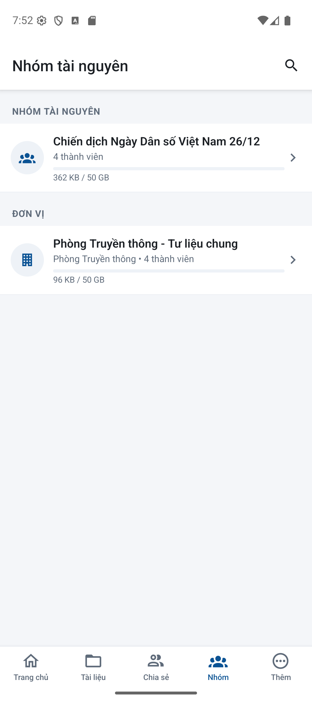 | 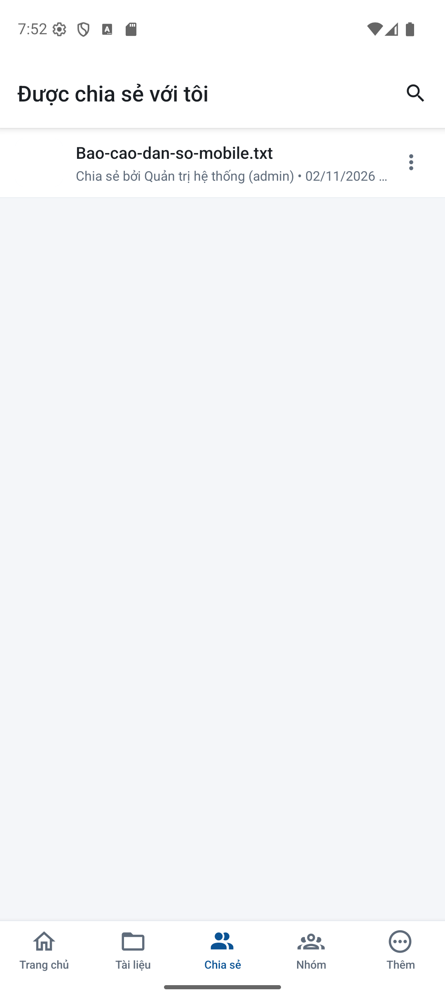 | 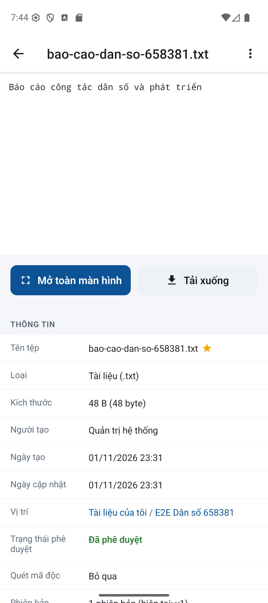 | 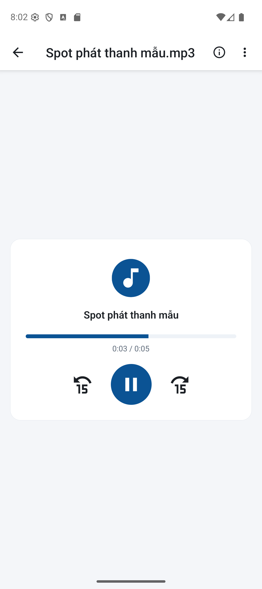 |
