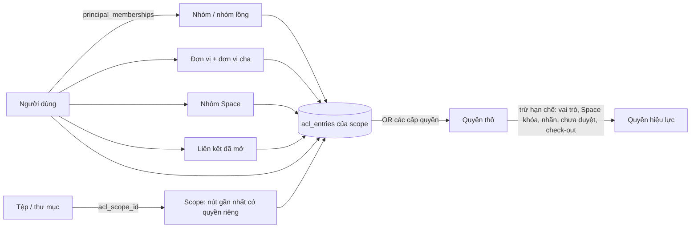

# Mô hình lưu trữ và phân quyền

Tài liệu này mô tả cách BlueDrive quyết định **ai được làm gì trên mục nào**, theo đặc tả `PROMPT_BlueDrive_Storage_Permissions.md`
(kiểu Google Drive + SharePoint). Ma trận cấp quyền × thao tác: [`permission-matrix.md`](permission-matrix.md). Chính sách chia sẻ nhiều tầng:
[`sharing-policies.md`](sharing-policies.md). Hiệu năng: [`perf-permissions.md`](perf-permissions.md). Chuyển dữ liệu từ mô hình cũ:
[`migration-permissions.md`](migration-permissions.md).

## 1. Khái niệm

| Khái niệm | Ý nghĩa | Bảng |
|---|---|---|
| **Drive của tôi** | Không gian riêng của mỗi người; chủ Drive có mọi quyền trên mục của mình. | `personal_drives` |
| **Space** | Không gian dùng chung (kiểu Shared drive / SharePoint site), có thành viên theo vai trò, trạng thái (hoạt động / lưu trữ / đã xóa), chính sách riêng. | `spaces` |
| **Thư viện** | Khu tài liệu trong Space / Drive (thư viện "Tài liệu" mặc định, thư mục cấp cao nhất bật *là thư viện*): phiên bản chính / phụ, check-out, phê duyệt, cột, dạng xem. | `libraries`, `library_settings` |
| **Securable** | Mọi nút của cây: Space, Drive, thư viện, thư mục, tệp, lối tắt. Đường dẫn `ltree` (`path`) giúp ngắt / khôi phục kế thừa bằng một câu UPDATE. | `securables` |
| **Principal** | Ai được cấp quyền: người dùng, khách, nhóm (có thể lồng nhau), đơn vị, *đơn vị gồm cả đơn vị con*, nhóm Space (Chủ sở hữu / Thành viên / Khách xem), "Mọi người trong đơn vị", liên kết chia sẻ. | `principals` |
| **Thành viên phẳng** | Mỗi người dùng → tập principal họ thuộc về (chính họ, nhóm kể cả lồng, đơn vị và đơn vị cha, nhóm Space, liên kết đã mở), kèm `membership_version` để vô hiệu cache. | `principal_memberships`, `membership_versions` |
| **Cấp quyền** | Tập quyền nguyên tử (25 quyền, `AccessRight`): 8 cấp có sẵn, sửa / thêm được. | `permission_levels` |
| **ACL scope** | Nút có *quyền riêng* (ngắt kế thừa) là một scope; mọi nút bên dưới không ngắt kế thừa trỏ `acl_scope_id` về nó. | `acl_scopes` (`acl_version`) |
| **Mục quyền (ACE)** | (scope, principal, cấp quyền, hết hạn, áp dụng cho mục con hay chỉ mục này, nguồn: trực tiếp / mặc định Space / liên kết / kế thừa / khẩn cấp). | `acl_entries` |
| **Scope grant** | Quyền đã gộp sẵn theo (scope, principal) để lọc danh sách ngay trong SQL. | `scope_grants` |



## 2. Thuật toán (đặc tả 4.3)

```
EffectivePermissions(user, item):
  1. principals = principal_memberships(user)                 -- cache theo membership_version
  2. scope      = item.acl_scope_id
  3. rights     = OR(level.permissions) của các ACE của scope có principal ∈ principals, chưa hết hạn,
                  và (áp dụng cho mục con hoặc item chính là scope)
  4. nếu item thuộc Drive của tôi và user là chủ → rights = ALL
  5. rights &= ~Hạn chế(item, user)    -- vai trò RBAC, Space khóa / lưu trữ / đã xóa, nhãn, chưa duyệt / bản nháp, check-out
  6. trả về rights
```

- Mã: `ItemPermissionService` (`src/BlueDrive.Application/Features/Access/ItemPermissionService.cs`), hạn chế ở `Restrictions.Apply`, nhãn ở `Labels.Apply`, trạng thái Space ở `SpaceState`.
- **Không lộ sự tồn tại**: không có `ViewItems` → 404 (không phải 403). Có `ViewItems` nhưng thiếu quyền khác → 403.
- **Bộ đánh giá tham chiếu** `ReferencePermissionEvaluator`: đi ngược từng nút lên gốc, không cache, không dùng `acl_scope_id`; property test so sánh hai bộ trên cây ngẫu nhiên (mục 5).

### Cache (3 tầng)

| Tầng | Khóa | Vô hiệu |
|---|---|---|
| Theo request | (user, item) | hết request |
| L0 quyết định (bộ nhớ) | (user, item) + `PermissionGeneration` | mỗi câu ghi vào bảng liên quan quyền (ACL, thành viên, cây, người dùng, vai trò, nhãn, Space, liên kết…) của tiến trình API — kể cả `ExecuteUpdate` và SQL thô — và khi commit transaction có ghi đó (`PermissionGenerationInterceptor`); tối đa 10 giây với thay đổi từ tiến trình Worker; không quá hạn của ACE sớm nhất |
| L2 quyền theo scope (bộ nhớ) | (user, scope, `membership_version`, `acl_version`) | tăng phiên bản khi sửa ACL / thành viên; hạn ACE sớm nhất |

### Lọc danh sách trong SQL (security trimming, đặc tả 4.4)

`AccessFilter` dựng truy vấn con trên `securables × scope_grants` (+ ACE "chỉ mục này", quy tắc chủ Drive, bản nháp / chưa duyệt) cho mọi danh
sách: thư mục, tìm kiếm, Gần đây, Có gắn sao, Được chia sẻ với tôi, Tôi đã chia sẻ, dashboard, thống kê, thông báo, gợi ý @nhắc tên, change feed
đồng bộ. Lọc **trước** khi phân trang nên số lượng và dung lượng không lộ mục bị cấm.

## 3. Ngắt / khôi phục kế thừa

- **Ngắt** (sao chép hoặc không): nút thành scope mới; các nút con đang trỏ scope cũ được trỏ lại bằng một câu `UPDATE … WHERE path <@ nút` (ltree), trong một transaction.
- **Khôi phục**: xóa ACE và scope của nút (và tùy chọn các nút con có quyền riêng), trỏ cây con về scope của cha.
- Chia sẻ một mục trong Space ở chế độ `sharepoint_scope` (mặc định) tự ngắt kế thừa kiểu sao chép rồi thêm ACE.

## 4. Ví dụ "Vì sao A thấy tệp X"

Space **Truyền thông** có nhóm Space *Thành viên* gồm nhóm **Phòng Nội dung** (A thuộc nhóm con **Tổ Biên tập**, lồng trong Phòng Nội dung). Thư
mục **Chiến dịch 2026** ngắt kế thừa và cấp *Người xem* cho đơn vị **Trung tâm** *gồm đơn vị con*. Tệp **Kế hoạch.docx** nằm trong thư mục đó.

1. Thành viên phẳng của A: {A, Tổ Biên tập, Phòng Nội dung, Phòng Truyền thông (đơn vị của A), Trung tâm (đơn vị cha, dạng "gồm con"), nhóm Space Thành viên — Truyền thông, Mọi người}.
2. Scope của Kế hoạch.docx = Chiến dịch 2026 (nút gần nhất có quyền riêng).
3. ACE của scope: *Chủ sở hữu — Truyền thông* (Chủ sở hữu, sao chép khi ngắt), *Thành viên — Truyền thông* (Biên tập, sao chép khi ngắt), *Trung tâm gồm con* (Người xem).
4. A khớp hai ACE: Biên tập (qua nhóm Space ← Phòng Nội dung ← Tổ Biên tập) và Người xem (qua Trung tâm ← Phòng Truyền thông). Quyền thô = OR = Biên tập.
5. Hạn chế: vai trò của A là *Chỉ xem* → bỏ mọi quyền ghi. **Kết quả: A xem, tải xuống, in, xem phiên bản — không sửa.**

Màn hình *Báo cáo quyền truy cập → Kiểm tra quyền* (và nút "Kiểm tra quyền" trong hộp thoại quyền) hiển thị đúng chuỗi trên: từng nguồn (trực tiếp
/ kế thừa từ đâu / qua nhóm nào / qua đơn vị nào / qua liên kết), cấp quyền, nơi áp dụng, hạn, và các hạn chế đã trừ.

## 5. Kiểm chứng

| Mục | Test |
|---|---|
| Bộ tính quyền ≡ bộ tham chiếu (cây ngẫu nhiên, nhóm lồng, đơn vị, ACE có hạn, ngắt / khôi phục, đổi thành viên, khóa Space, thời gian trôi; sau từng thay đổi) | `PermissionEngineProperties` (CI: 15 thế giới; kiểm tra phát hành: `PERM_PROPERTY_RUNS=800` = 10 400 kịch bản) |
| Ma trận cấp quyền × thao tác | `PermissionMatrixDocTests` (đọc `permission-matrix.md`) |
| Lọc trong SQL ở mọi kênh, không lộ tên / số lượng | `PermissionModelTests`, `SearchTests`, `DashboardTests`, `SyncTests`, `SecurityTests` |
| IDOR, dò token liên kết, tự nâng quyền, khách liệt kê người dùng | `SecurityTests`, `SharingModelTests.Guest_invited_by_email…` |
| Vòng đời (thùng rác 2 tầng + khôi phục quyền, lưu giữ, giữ pháp lý, nghỉ việc, chuyển quyền sở hữu, di chuyển Drive ↔ Space) | `AdvancedAdminTests`, `SpaceTests` |
| Hiệu năng (đặc tả 4.5) | `tests/BlueDrive.Benchmarks` → [`perf-permissions.md`](perf-permissions.md) |
